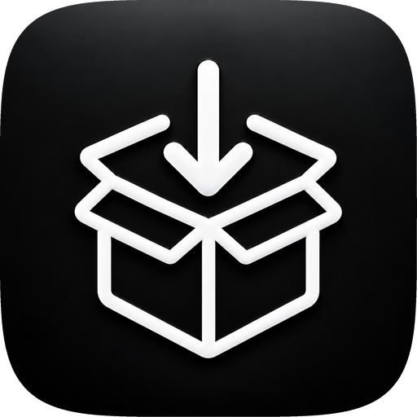
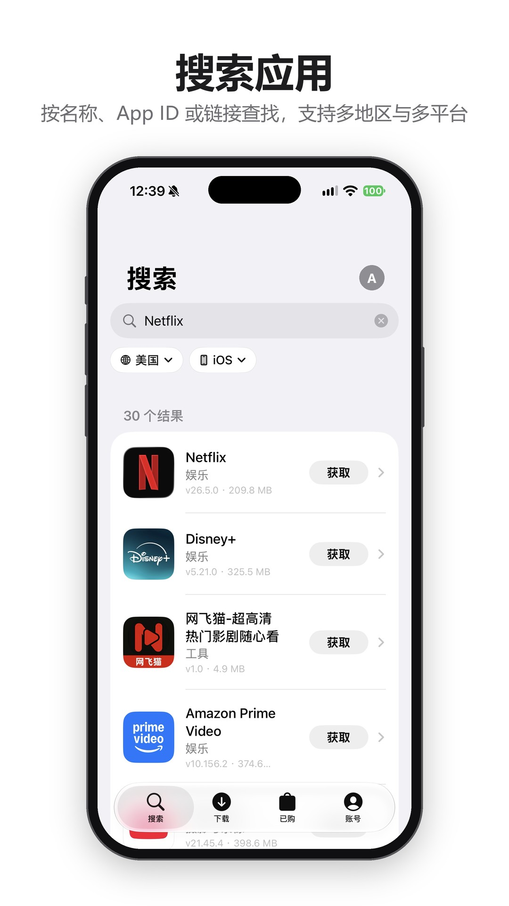
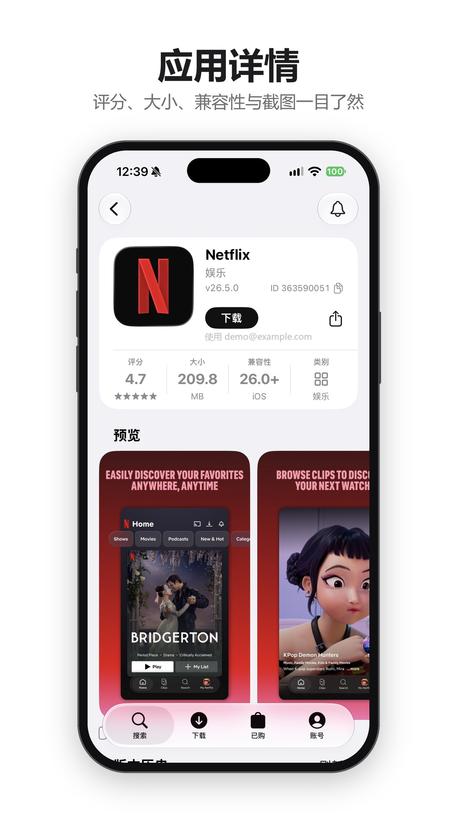
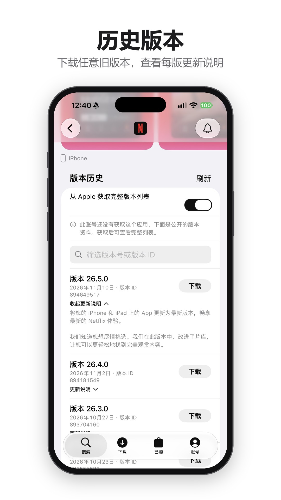
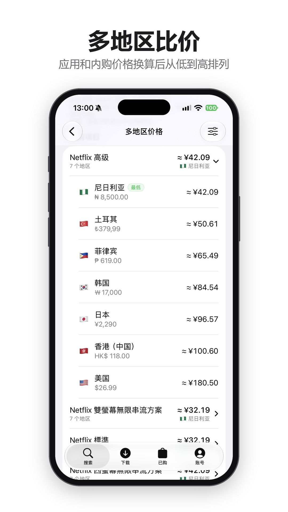
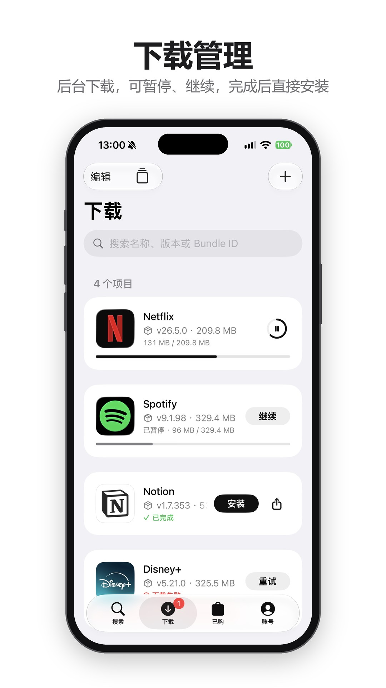
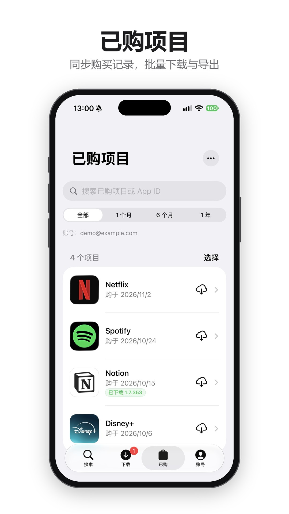
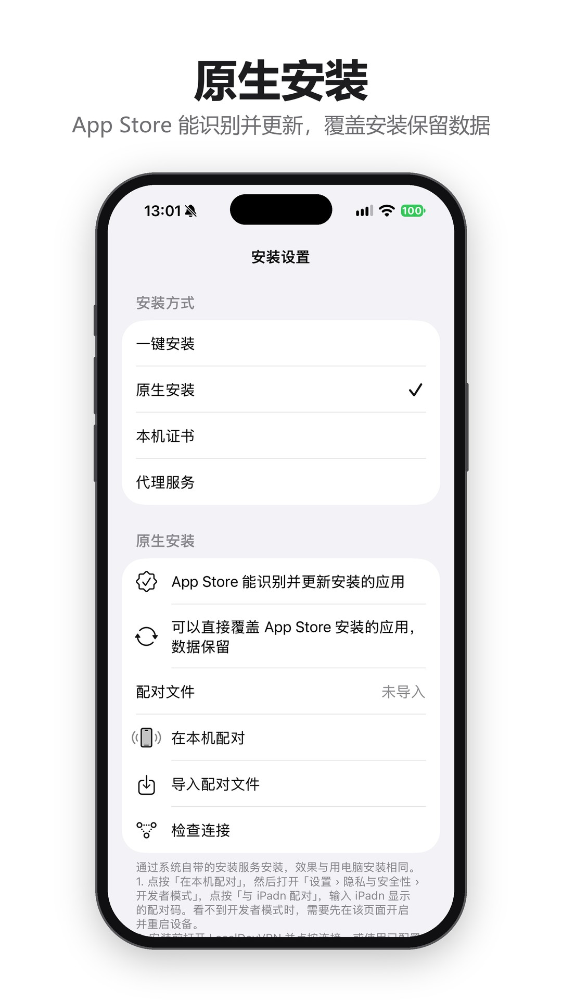
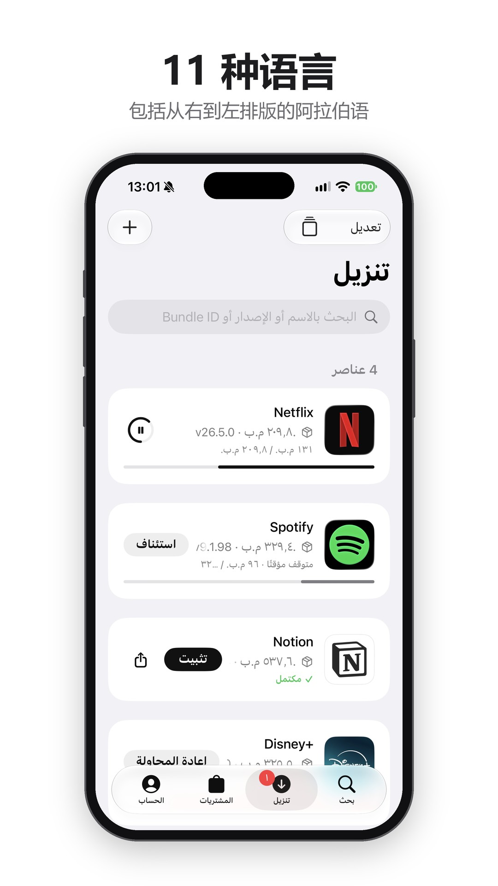

<div align="center">



# iPadn

**在 iPhone 和 iPad 上搜索、下载、安装你拥有的 App。**
支持 iPhone、iPad、Apple TV 与 Mac 应用，包括历史版本与已下架应用。

[](https://github.com/mengangs/ipadn/releases/latest)
[](https://github.com/mengangs/ipadn/releases)

[](LICENSE)

**简体中文** · [English](README_EN.md)

[下载](https://github.com/mengangs/ipadn/releases/latest) · [安装下载的应用](#安装下载的应用) · [常见问题](#常见问题) · [反馈问题](https://github.com/mengangs/ipadn/issues) · [支持 iPadn](#支持-ipadn)

</div>

<p align="center">
  
  
  
  
</p>

<p align="center">
  
  
  
  
</p>

---

## 开发中（尚未发布）

- 侧滑图标显露后独立播放完整动画：垃圾桶使用 Telegram 开源原画的盖子开合与回弹，分享保留分享图形并完成箭头起落、回弹归位；收起后重置。原生 Core Animation 播放，开启「减少动态效果」时显示静态完整图标。
- 下载卡片侧滑删除不再弹确认窗，显示 5 秒倒计时与撤销；连续删除可一起撤销。长按「删除任务及文件」和批量删除仍保留确认。搜索记录删除不再显示倒计时或撤销。
- 翻译默认保留原版系统面板。iOS 18 及以上可在「账号 › 设置 › 外观与图标 › 翻译」开启「直接替换翻译」，选择原文语言并准备语言包；译文跟随 iPadn 界面语言，可切回原文。

## 2.1.1 更新

- **修复 iOS 16 安装设置崩溃**：修正安装帮助链接的编码，并对无法构造的商店链接安全处理。
- **优化日期范围筛选排版**：起止日期、查询按钮和进度状态集中展示，对齐控件，并适配大字体，减少拥挤与错位。
- 继续提供标准版和精简版，支持 iOS / iPadOS 16 及更新版本。详见 [更新说明](RELEASE_NOTES.md)。

## 2.1.0 主要功能

- **历史版本更直观**：每行显示对应版本的真实主图标、IPA 大小和版本信息，方便对比活动角标；无需先下载完整安装包。仅含 Assets.car 的图标暂不支持，取不到时显示占位。
- **按日期找版本**：选择起止日期查询范围内的版本，支持进度、取消和未知日期提示；列表分批展开，图标按需加载并复用解码缓存。包内日期可能与商店发布日期不同。
- **下载操作更完整**：侧滑删除/分享、点击外部收起、5 秒撤销倒计时、完成状态过渡，以及原生方式下载完成后自动串行安装。
- **本机应用可查看本机详情**：商店资料缺失也能查看版本和 Bundle ID，区分地区无结果与查询失败，支持单独重试。
- 修复侧滑边缘裁剪、掉帧时收起过慢、重复安装排队及最近搜索标签圆角；标准版和精简版均保留。详见 [更新说明](RELEASE_NOTES.md)。

## 能做什么

| | |
| --- | --- |
| 🔍 **搜索与发现** | 输入应用名称、App ID 或 App Store 链接，切换商店地区和平台（iPhone / iPad / Apple TV / Mac）。最近搜索以标签显示；「发现」可在设置中关闭，开启时可浏览各地区的免费榜、付费榜和畅销榜并按分类筛选。详情页有截图预览、用户评论和同一开发者的其他应用。 |
| 🌐 **翻译** | 简介和更新说明不是你的语言时，默认打开系统翻译面板。iOS 18 及以上可在「设置 › 外观与图标 › 翻译」开启直接替换并提前准备语言包，译文跟随软件语言，可显示原文。 |
| 🕘 **历史版本** | 查看每个版本的版本号、日期、IPA 安装包大小、对应版本图标和更新说明并下载旧版本，也可以直接输入版本 ID。长按版本行可复制版本号或版本 ID；大字体下自动纵向排版。无法取得大小时显示「—」，不会套用最新版的大小。图标按需从对应 IPA 的主图标 PNG 读取并缓存，无法提取时显示占位，不套用当前商店图标；仅含 Assets.car 的版本暂不支持。已下载的应用可以「保留此版本」，不再提醒更新。 |
| ⬇️ **下载管理** | 后台下载，随时暂停、继续、重试，实时显示速度与剩余时间；锁屏和灵动岛同步显示进度。可以只在 Wi‑Fi 下下载，也可以下载完成后自动安装。卡片侧滑可删除或分享，点其他位置收起；分享文件名包含应用名和版本号。删除支持 5 秒撤销倒计时，下载完成后进度环变为勾号和「安装」。长按仍使用系统菜单，重复点当前标签页回到顶部。任务详情中能查看安装包声明的权限、扩展、语言等信息。 |
| 🔔 **更新提醒** | 已下载的应用有新版本时在列表里提示，后台检查后还会发送通知。 |
| ⬆️ **iPadn 自动更新提醒** | 有新版本时在「设置」中提示并发送通知，可以直接在 App 内查看更新内容、下载新安装包，交给你的签名工具安装。 |
| 👀 **关注应用** | 关注感兴趣的应用，有新版本、降价、限免或下架时提醒你，并记录价格走势。 |
| 🌏 **多地区比价** | 对比应用和内购项目（含订阅）在各个国家或地区的价格，按你选的货币换算后从低到高排列，对比的地区可以自己选。 |
| 📲 **一键安装** | 下载完成后点「安装」即可，无需描述文件或证书，并实时显示安装进度。 |
| 🧩 **原生安装** | 通过系统自带的安装服务安装，效果与用电脑安装相同：App Store 能识别并更新，可以直接覆盖 App Store 已装的版本并保留数据；需要时还可以阻止 App Store 更新这个应用。iOS 27 起可在手机上完成配对，不需要电脑。 |
| 📱 **本机应用** | 列出手机上已装的应用，找出 App Store 有新版本的应用一键全部更新。查不到商店资料的应用也能点开查看本机版本、Bundle ID 等信息，并区分当前地区未查到资料与查询失败，可单独重试商店查询。 |
| 💻 **Wi‑Fi 传输** | 在同一 Wi‑Fi 下的电脑浏览器中直接下载已完成的安装包，只在页面打开时运行。 |
| 💻 **Mac 应用** | 下载 Mac App Store 应用的 PKG 安装包，传到 Mac 上安装。 |
| 🛍️ **已购项目** | 同步你获取过的所有应用，按名称或时间查找，可多选批量下载；一键找出已下架但仍可下载的应用并全部备份，已购清单可以导出成表格。 |
| 📦 **已下架应用** | 只要你曾经获取过，下架应用也能通过 App ID 找到并下载。 |
| 👥 **多个账号** | 保存多个 Apple 账号（邮箱或手机号），一键切换。 |
| 🎮 **Apple Arcade** | 订阅了 Apple Arcade 的账号可以下载 Arcade 游戏。 |
| 🔒 **应用锁** | 用面容 ID、触控 ID 或密码锁住 iPadn，多任务界面中也会隐藏内容。 |
| 🧭 **小组件与快捷指令** | 主屏幕和锁屏小组件快速打开搜索、下载、已购和更新检查；快捷指令可以下载应用、检查更新、查看下载进度、关注应用等。 |
| 🧰 **专业模式** | 浏览安装包内的文件并提取，对比同一应用的两个已下载版本，查看账号令牌和设备标识（默认关闭）。 |

界面参考 App Store 设计，外观默认跟随系统、图标默认深色（都可在设置中更改），支持动态字体和 iPad 侧栏，还可以在设置中更换应用图标。

**界面语言**：简体中文、繁體中文、English、日本語、한국어、Русский、Español、Français、Deutsch、Português (Brasil)、العربية，阿拉伯语使用从右到左的排版。iPadn 跟随系统语言，也可以在「设置 › iPadn › 语言」中单独设置。英文由社区贡献者完善，其他语言为机器辅助翻译，欢迎在 [Issues](https://github.com/mengangs/ipadn/issues) 或 Pull Request 中纠错。

## 开始使用

> 需要 **iOS / iPadOS 16** 或更新版本。

1. 在 [Releases](https://github.com/mengangs/ipadn/releases/latest) 下载最新的 `iPadn-版本号-unsigned.ipa`。签名工具或免费账号的 App ID 数量有限时，可以改用精简版 `iPadn-版本号-lite-unsigned.ipa`：只需 1 个 App ID，但没有灵动岛进度和小组件。
2. 用你常用的签名工具签名后安装到设备上。
3. 打开 iPadn，在「账号」中登录 Apple 账号。需要双重认证时，输入受信任设备上显示的 6 位验证码。

> iPadn 不在 App Store 上架，发布的安装包未签名，需要自行签名。

### 在签名工具中添加源

SideStore、AltStore、Feather 等支持 AltStore 源的签名工具，可以添加下面的地址。添加后在工具里就能安装 iPadn，有新版本时也能直接在工具里更新，不用再手动下载安装包。

```
https://raw.githubusercontent.com/mengangs/ipadn/main/altstore-source.json
```

源文件在每次发布后自动更新，只列出本仓库 Releases 中的安装包。

## 下载一个应用

1. 在 **搜索** 中输入应用名称、App ID 或 App Store 链接。
2. 点「获取」直接下载最新版本；或打开应用详情，在 **版本历史** 中选择旧版本。
3. 在 **下载** 中查看进度，完成后点「安装」或分享按钮。

**小技巧**

- 想下载 Apple TV 或 iPad 版本：在搜索框下方把平台切换为对应设备。
- 找不到已下架的应用：直接搜索它的 App ID。
- 登录后详情页默认从 Apple 获取完整版本列表；账号没获取过的应用会显示公开的版本资料。
- 长按下载卡片可以查看详情、导出文件或删除任务。
- 想一次下载多个已购应用：在「已购」点「选择」，勾选后点「下载所选」。
- 安装包太占空间：在「账号 › 设置 › 存储空间」一键删除旧版本安装包。
- 历史版本查不全：在「账号 › 设置」的版本来源列表中点「检测全部来源」，查看每个来源是否可用；接口地址里用 `{id}` 或 `{appId}` 代表 App ID。

## 安装下载的应用

手动安装时，点下载卡片上的「安装」，按所选安装方式完成操作；网页安装方式需要在系统弹窗中确认，完成前请保持 iPadn 打开。

开启「下载完成后自动安装」并选择「原生安装」后，完成的任务会依次直接安装，无需再次确认；需事先完成配对并保持 LocalDevVPN 连接。下载到安装期间使用静音音频维持后台运行，锁屏和灵动岛可显示下载、处理和安装状态（标准版，需开启实时活动）。后台运行仍受 iOS 限制，不能保证被系统终止后继续；未完成的任务会在重新打开 iPadn 后恢复处理。其他安装方式仍需回到 iPadn，由安装页和系统提示完成。

在「账号 › 设置 › 安装设置」中可以选择安装方式：

| 方式 | 适合谁 | 需要准备 |
| --- | --- | --- |
| **一键安装**（推荐） | 所有人 | 无需任何设置，安装时联网即可 |
| **原生安装** | 希望 App Store 能识别、更新安装的应用，或要覆盖 App Store 已装版本 | LocalDevVPN 和一次配对，见下文 |
| **本机证书** | 一键安装没有弹出安装窗口时（例如在 LiveContainer 中运行） | 在安装设置中创建证书，安装描述文件，并在「设置 › 通用 › 关于本机 › 证书信任设置」中开启信任 |
| **代理服务** | 已在使用 Surge、Loon 等工具 | 自己的清单服务地址与代理规则 |

使用本机证书安装时，系统会提示「ipadn.localtest.me 想要安装…」，这是 iPadn 在本机提供的安装服务。使用 Surge、Loon、Shadowrocket 等代理工具时，不用关闭代理，只需添加直连（DIRECT）规则：一键安装为 `api.palera.in`，本机证书为 `ipadn.localtest.me`。

安装时会显示进度：系统开始安装、安装包传输百分比和传输完成。如果点「安装」后没有出现系统安装窗口，可以点「在 Safari 中安装」，在 Safari 中确认后回到 iPadn 等待完成。

一键安装、本机证书和代理服务使用的系统网页安装通道不能覆盖 App Store 已装的同一应用，需要覆盖时请用「原生安装」。

### 原生安装

一键安装、本机证书和代理服务都通过系统的网页安装通道完成。这样装的应用，App Store 不会显示为已安装，也不能更新；爱思助手等工具会显示为「共享正版」；也不能覆盖 App Store 已装的同一应用。原生安装改用电脑安装软件所用的系统安装服务，安装结果与用电脑安装相同：App Store 能识别和更新，可以直接覆盖 App Store 版本并保留数据。安装包不会离开这台设备。

**1. 安装 LocalDevVPN**

从 App Store 安装 [LocalDevVPN](https://apps.apple.com/app/localdevvpn/id6755608044)。它只在本机内部转发连接，不经过外部服务器。每次原生安装前先在 LocalDevVPN 中点按连接。

**2. 配对（只需一次）**

- **iOS / iPadOS 27 及更新版本，不需要电脑**：在「安装设置 › 原生安装」中点按「在本机配对」，iPadn 会打开引导页。按提示打开「设置 › 隐私与安全性 › 开发者模式」，点按「与 iPadn 配对」，输入 iPadn 显示的配对码。配对码同时显示在灵动岛、锁屏和通知中，不用切回 iPadn。需要先开启开发者模式；看不到这个开关时，说明设备上还没有用开发者证书签名的应用，用企业证书签名时可能不会出现。
- **iOS 17.4 – 26**：在电脑上用 [idevice_pair](https://github.com/jkcoxson/idevice_pair) 连接设备，生成「远程配对（RPPairing）」文件，放进「文件 › 我的 iPhone › iPadn」，在「原生安装」页 iPadn 会自动导入；也可以点「导入配对文件」从其他位置选取。电脑只需要用这一次，之后安装都不再需要电脑。

**3. 检查连接**

在 LocalDevVPN 中连接后，回到 iPadn 点「检查连接」，显示连接正常即可安装。

修改锁屏密码、系统还原或在电脑上取消信任后，配对会失效，需要重新配对。配对文件相当于这台设备的连接凭据，不要分享给他人。

也可以点分享按钮，把安装包交给其他安装工具。

## Mac 应用

1. 在搜索框下方把平台切换为 **Mac**。
2. 打开应用详情，点「获取 PKG」。
3. 下载完成后点分享按钮，通过隔空投送或「文件」传到 Mac 上安装。

第一次下载 Mac 应用时，iPadn 会额外下载约 47 MB 的组件，之后会重复使用。开发者在官网提供的 DMG / PKG / ZIP 也可以在详情页直接下载。

## 专业模式

在「账号 › 设置」中打开「专业模式」后：

- 下载任务详情中可以「浏览安装包内容」，查看任意文件并提取分享，文本和图片可直接预览。
- 「安装包信息」中可以和同一应用的其他已下载版本对比，查看版本、权限、扩展、框架等变化。
- 设置中会出现「账号与设备标识」，可以查看账号令牌和修改设备标识。令牌可以直接访问你的 Apple 账号，请勿分享给任何人；修改设备标识后账号可能需要重新登录。

## 你的数据

- 账号信息只保存在你的设备上，验证码不会被保存。
- 下载的安装包只保存在本机，不会上传到任何地方。「Wi‑Fi 传输」只在你打开它的页面时运行，地址带随机密钥，只接受同一局域网内的设备，离开页面即停止。
- 比价时会从 open.er-api.com 获取参考汇率，请求中不包含你的账号信息。
- 移除账号不会删除已下载的安装包；删除下载任务时会一并删除对应文件，操作前会再次确认。

## 常见问题

<details>
<summary><b>为什么某个应用或版本无法下载？</b></summary>

Apple 只允许下载你的账号拥有许可的应用。版本也可能已经下架或不在当前地区提供。可以换一个版本、切换商店地区，或切换到拥有该应用的账号。
</details>

<details>
<summary><b>点「安装」后没有反应？</b></summary>

请确认设备已联网，并在系统弹窗中点「安装」。没有出现系统弹窗时，可以点「在 Safari 中安装」，或在安装设置中改用「本机证书」（在 LiveContainer 中运行时尤其需要）。仍不行的话，可以分享安装包给其他安装工具，或在「设置 › 维护」中导出诊断信息反馈给我们。
</details>

<details>
<summary><b>在 LiveContainer 中无法导入导出文件，或一键安装没有反应？</b></summary>

在 LiveContainer 里长按 iPadn，打开设置中的「修复文件导入」（Fix File Picker）。之后就能导入导出安装包和诊断信息，一键安装也能弹出系统安装窗口。
</details>

<details>
<summary><b>安装时提示「已经安装，请删除后重试」？</b></summary>

一键安装、本机证书和代理服务走的是系统的网页安装通道，系统不允许它覆盖 App Store 安装的同一应用，这是 iOS 的限制。请改用「原生安装」，可以直接覆盖并保留数据。原生安装仍会被拒绝的情况：要装的版本比设备上的旧（系统不允许降级），或设备上的应用来自 TestFlight、其他签名工具等不同渠道。
</details>

<details>
<summary><b>为什么 App Store 里显示云朵、不能更新，爱思助手显示「共享正版」？</b></summary>

这是用一键安装、本机证书或代理服务安装的应用。系统网页安装通道会去掉安装包里的购买记录，App Store 和电脑工具因此认不出它。用「原生安装」重新覆盖安装一次即可恢复，数据会保留。
</details>

<details>
<summary><b>为什么 iOS 27 以下要用电脑才能配对？用一次就行吗？</b></summary>

原生安装使用的是系统自带的安装服务，和电脑装 App 用的是同一个，它只接受已经配对、受信任的连接。iOS 27 之前，苹果只允许电脑通过数据线发起这种配对（手机上点「信任此电脑」并输入密码），手机上的 App 无法自己发起，所以需要先在电脑上生成配对文件。iOS 27 在「开发者模式」中加入了在手机上配对的入口，因此可以直接用「在本机配对」。

电脑只需要用一次。配对文件导入 iPadn 后会一直有效，只有修改锁屏密码、还原系统，或在电脑上取消信任后才需要重新生成。iOS 17.4 以下没有这套连接方式，无法使用原生安装。
</details>

<details>
<summary><b>原生安装提示无法连接本机安装服务？</b></summary>

- 先在 LocalDevVPN 中点按连接，并保持 Wi-Fi 开启。
- LocalDevVPN 与其他代理或 VPN 不能同时开启。Surge、Shadowrocket、Egern 等工具需要把 `10.7.0.1/32` 加入路由才可能代替 LocalDevVPN，这种用法尚未测试。
- 提示配对文件失效时，重新配对一次（iOS 27 及更新版本可直接点「在本机配对」）。
</details>

<details>
<summary><b>在本机配对时看不到配对码，或「设置」里没有「与 iPadn 配对」？</b></summary>

- 本机配对需要 iOS / iPadOS 27 及更新版本，并且已开启「开发者模式」。
- 点「在本机配对」后再去「设置」，配对期间 iPadn 会在后台保持运行；配对码显示在灵动岛、锁屏和通知中。请在「设置 › iPadn」中允许通知和「实时活动」。
- 等待超过 5 分钟会自动停止，重新点「在本机配对」即可。
</details>

<details>
<summary><b>下载或获取应用时要求输入验证码，但没有收到？</b></summary>

- iPadn 会先替你向 Apple 请求验证码，验证码只发到登录了同一 Apple 账户的 iPhone、iPad 或 Mac，不发短信。设备上出现「Apple 账户登录请求」时点「允许」。
- 没有出现时，可以在那台设备的「设置 › [你的姓名] › 登录与安全 › 获取验证码」中手动获取，同样可用。
- 可以点「重新发送验证码」，频繁请求时 Apple 可能会暂时不发送。
- 获取免费应用也要求验证，通常是 Apple 账户开启了免费下载需要密码。可以在登录了该账户的设备上打开「设置 › 媒体与购买项目 › 密码设置」关闭；开着「使用面容 ID 购买」时没有这个选项。
- Apple 有时会根据风控要求重新验证，这由 Apple 决定，验证后下载会自动继续。
</details>

<details>
<summary><b>点「获取」后要转一会才开始下载？</b></summary>

每次请求都要先在本机完成 Apple 要求的签名。刚打开 iPadn 或闲置超过 5 分钟后，签名组件需要重新加载几秒；从没下载过的应用还要先领取许可，多两次 Apple 请求。iPadn 打开应用详情页时会提前准备签名组件，下载操作也会排在后台任务前面。
</details>

<details>
<summary><b>下载到 100% 后又从头开始？</b></summary>

部分签名方式下，系统后台下载服务无法把文件存进 iPadn，只能改用应用内下载从头再下。iPadn 每次安装后第一次启动会先用一个很小的文件检测，检测到问题就直接改用应用内下载，不会再下两遍。应用内下载时请保持 iPadn 在前台，退到后台约 30 秒后会暂停。更换签名后可以在「设置 › 下载」点「重新尝试后台下载」。
</details>

<details>
<summary><b>已下架的应用怎么找？</b></summary>

在搜索中输入它的 App ID。只要你的账号曾经获取过这个应用，就可以继续下载。下载过一次后，它的图标也会被记住。
</details>

<details>
<summary><b>下载卡住了怎么办？</b></summary>

检查网络后暂停再继续。下载失败的任务可以直接点「重试」，不会重复添加。
</details>

<details>
<summary><b>可以下载 TestFlight 测试版吗？</b></summary>

暂不支持。已有的 IPA 文件可以通过下载页右上角的「+」导入管理。
</details>

<details>
<summary><b>多地区比价里只显示了中国区的内购？</b></summary>

在中国大陆网络下，Apple 会把其他地区的 App Store 页面转到中国区，因此读不到外区的内购价格（应用本身的价格不受影响）。在代理工具中让 apps.apple.com 走代理后，下拉刷新即可。
</details>

<details>
<summary><b>移除账号会删除已下载的应用吗？</b></summary>

不会。移除账号只清除该账号的登录信息和已购记录。
</details>

## 支持 iPadn

<div align="center">

<sub>❤️ ❤️ ❤️</sub>

iPadn 会一直**免费、开源、没有广告**。<br>
如果它帮你省下了时间，或者你只是喜欢这个项目，欢迎请作者喝杯咖啡 ☕<br>
你的鼓励是持续更新的动力。

<a href="https://afdian.com/a/mengangs"></a>


| 爱发电（支付宝、微信） | USDT（BNB Smart Chain / BEP20） |
| :---: | :---: |
| [**afdian.com/a/mengangs**](https://afdian.com/a/mengangs)<br><sub>可按月赞助，也可一次性支持</sub> | <br><code>0x5f0cff7587b9fc305f9fa626135789bd5100818e</code> |

<sub>转账 USDT 前请核对网络为 BEP20、地址完全一致，其他网络或币种转入可能无法找回。<br>在 iPadn「账号 › 设置 › 支持 iPadn」中也可以扫码或复制地址。<br>点个 Star、反馈问题或帮忙改进翻译，同样是很大的支持。</sub>

</div>

## 参与贡献

- **翻译**：所有界面文字在 [`Localizable.xcstrings`](iPadn-iOS/iPadn/Resources/Localizable.xcstrings) 中，用 Xcode 打开即可逐条编辑。改进现有语言或新增语言都欢迎提交 Pull Request。
- **反馈问题**：在 [Issues](https://github.com/mengangs/ipadn/issues) 中描述设备、系统版本和操作步骤；方便的话附上「账号 › 设置 › 导出诊断信息」生成的文件，其中不含账号名称和登录凭据。
- **自行编译**：步骤见 [BUILDING.md](iPadn-iOS/BUILDING.md)。

## 致谢

- [kylefmohr](https://github.com/kylefmohr) 贡献了英文翻译（[#35](https://github.com/mengangs/ipadn/pull/35)）。
- 感谢所有提交问题和建议的用户，以及 iPadn 使用的开源项目，详见[第三方组件与许可](iPadn-iOS/THIRD_PARTY_NOTICES.md)。

## 更多

- [更新内容](RELEASE_NOTES.md)
- [自行编译](iPadn-iOS/BUILDING.md)
- [第三方组件与许可](iPadn-iOS/THIRD_PARTY_NOTICES.md)

## 许可证

iPadn 以 [GPL-2.0-or-later](LICENSE) 发布：你可以自由使用、修改和再分发，分发修改版时需要同样开放源代码。

<sub>iPadn 与 Apple Inc. 无关。请只下载你拥有合法许可的应用。</sub>
