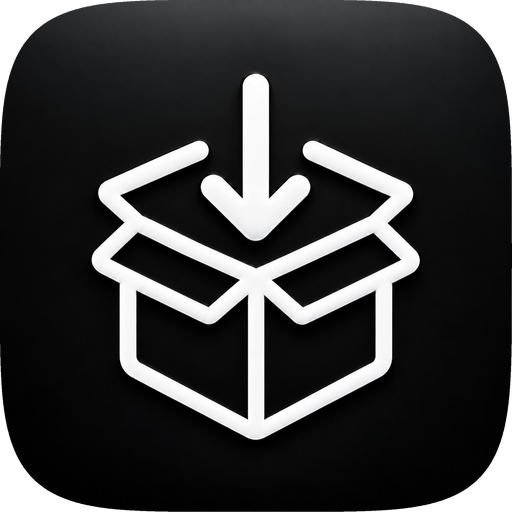
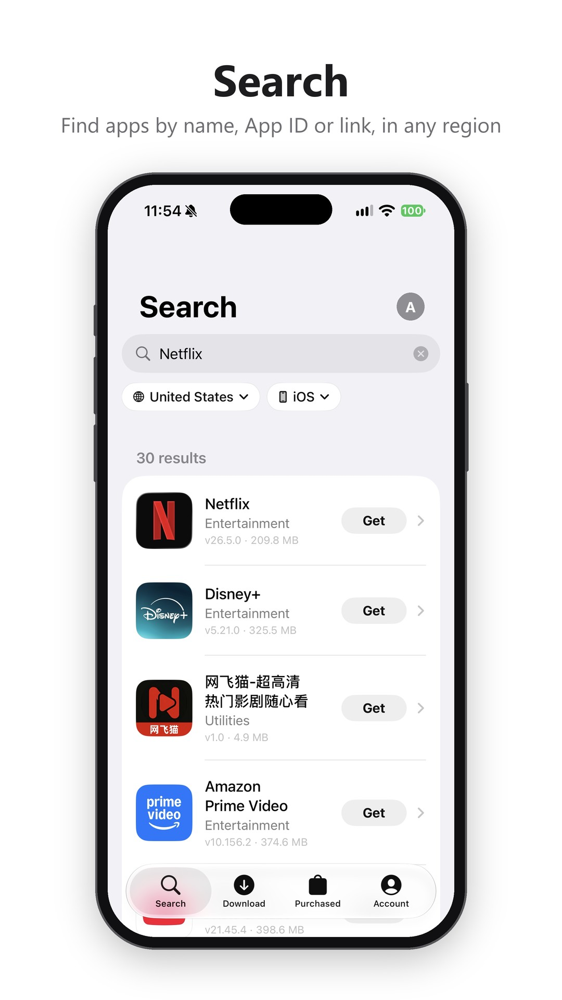
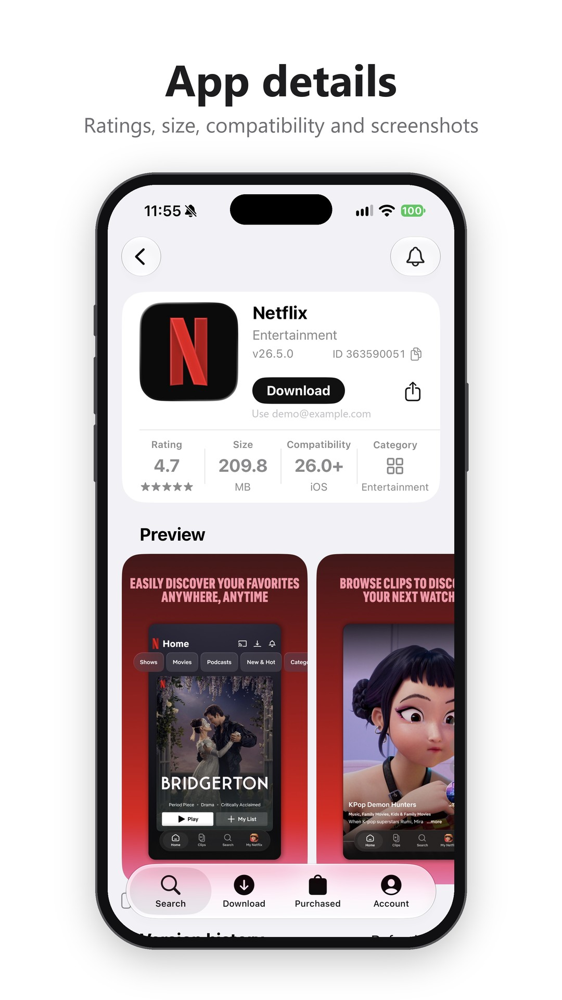
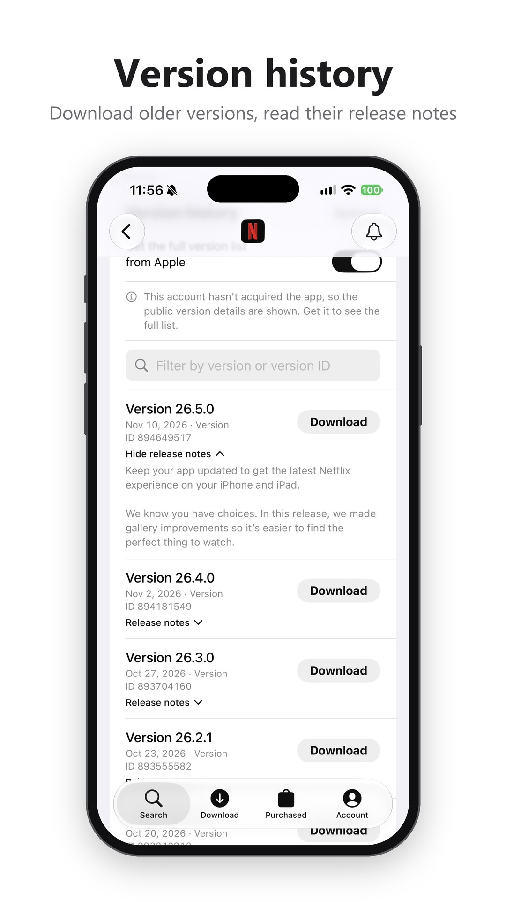
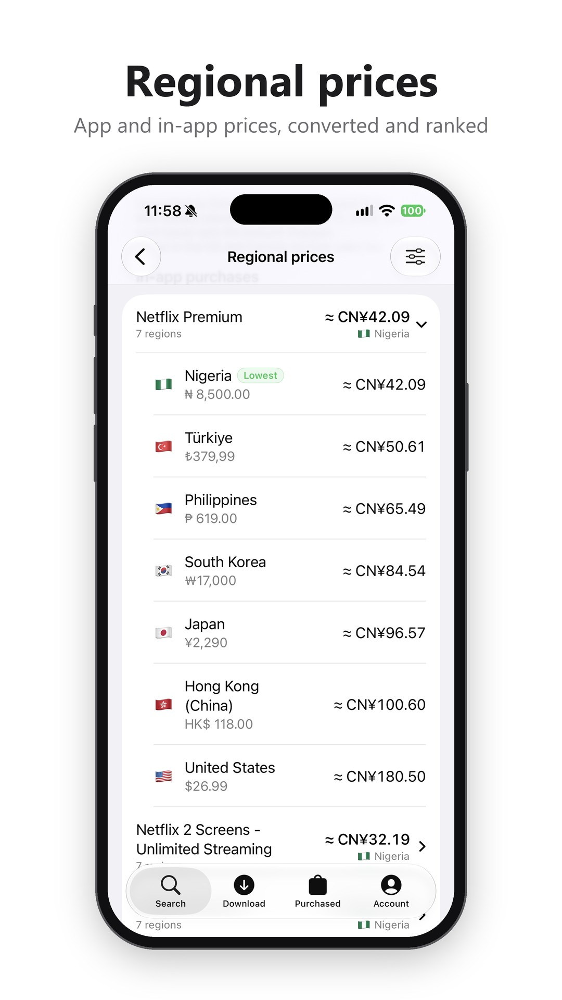
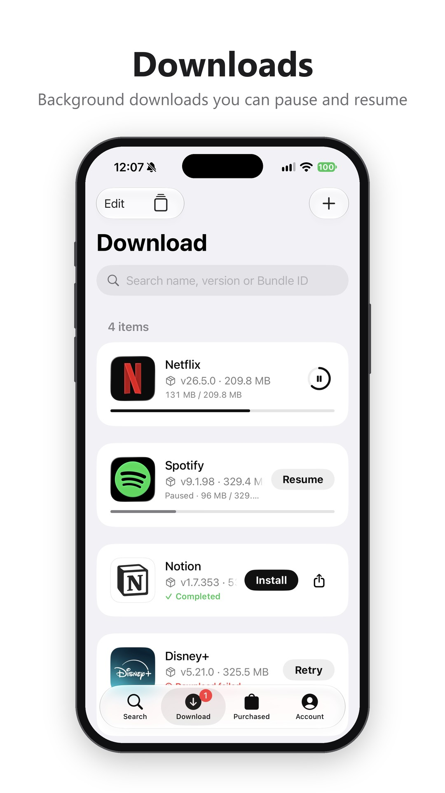
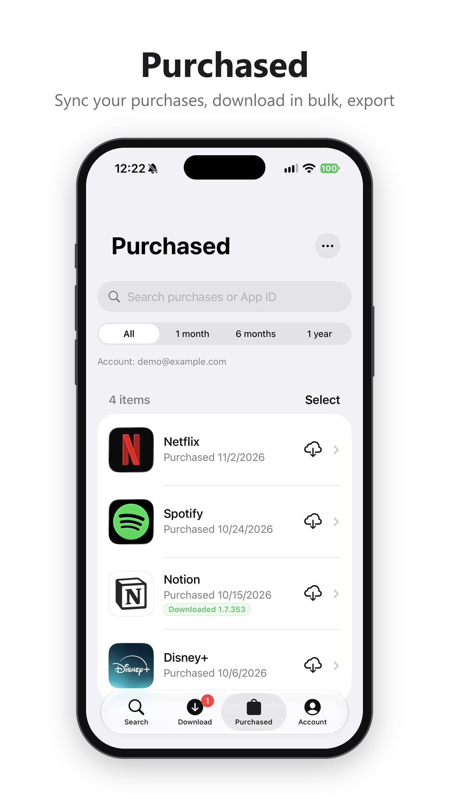
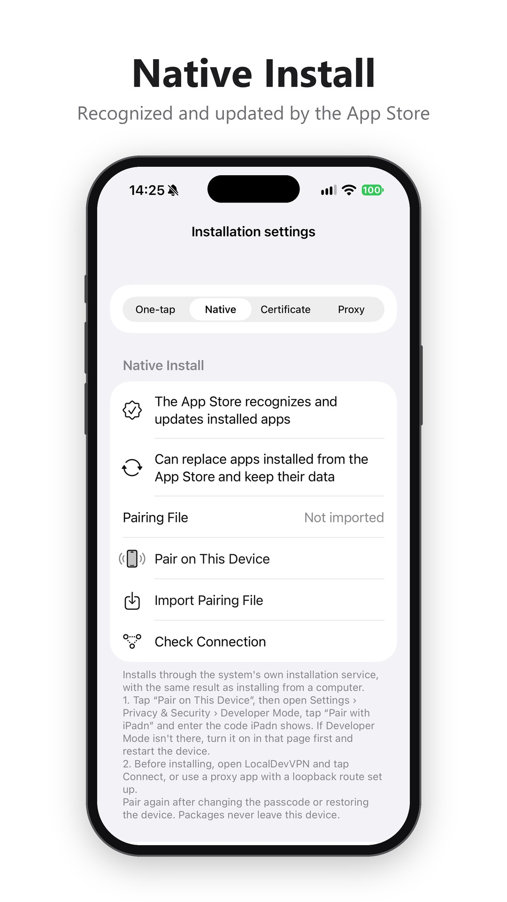
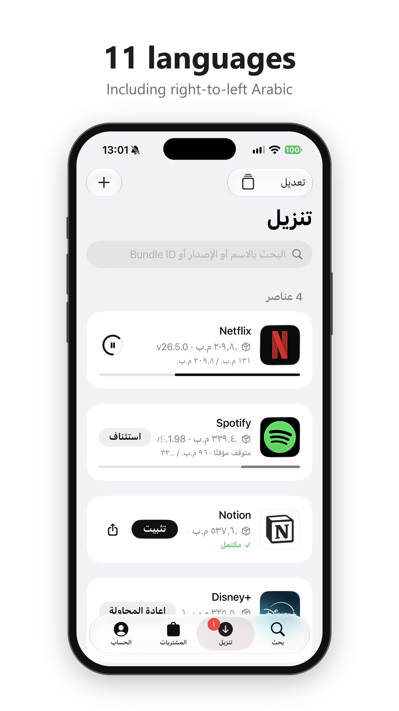
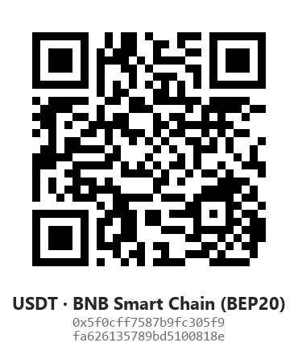

<div align="center">



# iPadn

**Search, download and install the apps you own, on iPhone and iPad.**
Works with iPhone, iPad, Apple TV and Mac apps, including older versions and apps removed from sale.

[](https://github.com/mengangs/ipadn/releases/latest)
[](https://github.com/mengangs/ipadn/releases)

[](LICENSE)

[简体中文](README.md) · **English**

[Download](https://github.com/mengangs/ipadn/releases/latest) · [Install a download](#installing-a-downloaded-app) · [FAQ](#frequently-asked-questions) · [Report a problem](https://github.com/mengangs/ipadn/issues) · [Support iPadn](#support-ipadn)

</div>

<p align="center">
  
  
  
  
</p>

<p align="center">
  
  
  
  
</p>

---

## What it does

| | |
| --- | --- |
| 🔍 **Search** | Search by app name, App ID or App Store link, and switch storefront region and platform (iPhone / iPad / Apple TV / Mac). App pages show screenshots and other apps by the same developer. |
| 🕘 **Older versions** | See each version's number, date and release notes and download older versions, or enter a version ID directly. Downloaded apps can “Keep this version” to stop update reminders. |
| ⬇️ **Downloads** | Background downloads you can pause, resume and retry, with live speed and time remaining. |
| 🔔 **Update alerts** | Downloaded apps with a newer version are marked in the list, and background checks send a notification. |
| ⬆️ **iPadn updates** | New iPadn releases appear in Settings with a notification; read what's new, download the new package and hand it to your signing tool. |
| 👀 **Follow apps** | Get notified about new versions, price drops, free promotions or removals, with a price history. |
| 🌏 **Regional prices** | Compare app and in-app purchase prices (including subscriptions) across regions, converted to your chosen currency and sorted from lowest. You pick the regions. |
| 📲 **One-tap install** | Tap “Install” when a download finishes. No profile or certificate needed, with live progress. |
| 🧩 **Native install** | Installs through the system's own installation service, with the same result as installing from a computer: the App Store recognizes and updates the app, and an App Store copy can be replaced in place with its data kept. From iOS 27, pairing is done on the device without a computer. |
| 💻 **Mac apps** | Download PKG installers of Mac App Store apps and install them on a Mac. |
| 🛍️ **Purchases** | Sync every app you've acquired, find them by name or date, and download several at once. Find removed apps that can still be downloaded and back them all up; export the list as a spreadsheet. |
| 📦 **Removed apps** | If you acquired an app once, you can find it by App ID and download it even after it's removed from sale. |
| 👥 **Multiple accounts** | Save several Apple Accounts (email or phone number) and switch with one tap. |
| 🎮 **Apple Arcade** | Accounts subscribed to Apple Arcade can download Arcade games. |
| 🧰 **Pro mode** | Browse and extract files inside a package, and view account tokens and the device identifier (off by default). |

The interface follows the App Store's design. Appearance follows the system and the icon is dark by default (both can be changed in Settings), with Dynamic Type, the iPad sidebar and alternate app icons.

**Languages:** English, Simplified Chinese, Traditional Chinese, Japanese, Korean, Russian, Spanish, French, German, Portuguese (Brazil) and Arabic, with a right-to-left layout for Arabic. iPadn follows the system language; to choose a different one for iPadn only, use Settings › iPadn › Language. English was refined by a community contributor and the other languages are machine-assisted translations; corrections are welcome in [Issues](https://github.com/mengangs/ipadn/issues) or a pull request.

## Getting started

> Requires **iOS / iPadOS 16** or later.

1. Download the latest `iPadn-<version>-unsigned.ipa` from [Releases](https://github.com/mengangs/ipadn/releases/latest).
2. Sign it with your usual signing tool and install it on your device.
3. Open iPadn and sign in to your Apple Account under Account. If two-factor authentication is on, enter the 6-digit code shown on your trusted device.

> iPadn isn't on the App Store. Releases are unsigned, so you need to sign them yourself.

### Add the source to your signing tool

SideStore, AltStore, Feather and other tools that support AltStore sources can add the address below. You can then install iPadn from the tool and update it there when a new version is out, without downloading the package by hand.

```
https://raw.githubusercontent.com/mengangs/ipadn/main/altstore-source.json
```

The source is updated automatically after every release and only lists packages from this repository's Releases.

## Downloading an app

1. In **Search**, enter an app name, App ID or App Store link.
2. Tap “Get” to download the latest version, or open the app page and choose an older version under **Version history**.
3. Follow the progress in **Downloads**, then tap “Install” or the share button.

**Tips**

- For Apple TV or iPad versions, switch the platform below the search field.
- Can't find a removed app? Search for its App ID.
- When signed in, app pages load the full version list from Apple; apps your account hasn't acquired show the public version details.
- Touch and hold a download card to see details, export the file or delete the task.
- To download several purchases at once, tap “Select” in Purchased, tick them and tap “Download selected”.
- Packages taking too much space? Delete older versions in one go under Account › Settings › Storage.
- Version history incomplete? In the version source list under Account › Settings, tap “Check All Sources” to see whether each source works. In an endpoint URL, `{id}` or `{appId}` stands for the App ID.

## Installing a downloaded app

Tap “Install” on the download card and confirm in the system prompt. Don't leave iPadn until the installation finishes.

Choose the install method under Account › Settings › Installation settings:

| Method | For | What you need |
| --- | --- | --- |
| **One-tap install** (recommended) | Everyone | Nothing to set up; a network connection while installing |
| **Native install** | Getting App Store recognition and updates, or replacing an App Store copy | LocalDevVPN and a one-time pairing, see below |
| **Local certificate** | When one-tap install shows no prompt (for example inside LiveContainer) | Create a certificate in Installation settings, install its profile, and enable trust under Settings › General › About › Certificate Trust Settings |
| **Proxy service** | People already using Surge, Loon and similar tools | Your own manifest service address and proxy rules |

With a local certificate, the system asks “ipadn.localtest.me would like to install…”: that's the installation service iPadn runs on your device. With Surge, Loon, Shadowrocket or another proxy, you don't need to turn it off; add a DIRECT rule instead: `api.palera.in` for one-tap install, `ipadn.localtest.me` for a local certificate.

Installation shows its progress: the system starting, the package transfer percentage, and the transfer finishing. If no system prompt appears after tapping “Install”, tap “Install in Safari”, confirm there, then return to iPadn and wait.

One-tap install, local certificate and proxy service use the system's web installation channel, which can't replace an App Store copy of the same app. Use native install for that.

### Native install

One-tap install, local certificate and proxy service all go through the system's web installation channel. Apps installed that way aren't shown as installed in the App Store and can't be updated there; desktop tools such as 3uTools list them as “shared”; and they can't replace an App Store copy of the same app. Native install uses the installation service desktop tools use instead, with the same result as installing from a computer: the App Store recognizes and updates the app, and an App Store copy is replaced in place with its data kept. Packages never leave your device.

**1. Install LocalDevVPN**

Get [LocalDevVPN](https://apps.apple.com/app/localdevvpn/id6755608044) from the App Store. It only forwards connections inside your device and doesn't go through any outside server. Tap Connect in it before each native install.

**2. Pair (once)**

- **iOS / iPadOS 27 or later, no computer:** In Installation settings › Native install, tap “Pair on This Device”. iPadn opens a guide. Open Settings › Privacy & Security › Developer Mode, tap “Pair with iPadn” and enter the code iPadn shows. The code also appears in the Dynamic Island, on the Lock Screen and in a notification, so you don't need to switch back. Developer Mode must be on; if the switch isn't there, the device has no developer-signed app yet, and it may not appear with enterprise signing.
- **iOS 17.4 – 26:** On a computer, connect the device with [idevice_pair](https://github.com/jkcoxson/idevice_pair) and create a remote pairing (RPPairing) file. Put it in Files › On My iPhone › iPadn and open the Native install page: iPadn imports it automatically. You can also tap “Import Pairing File” to pick it from elsewhere. You only need the computer this once; later installs don't need it.

**3. Check the connection**

Connect in LocalDevVPN, return to iPadn and tap “Check Connection”. Once it says connected, you can install.

Pairing stops working after changing the passcode, restoring the device or untrusting the computer; pair again then. The pairing file is a connection credential for your device, so never share it.

You can also tap the share button to hand the package to another installation tool.

## Mac apps

1. Switch the platform below the search field to **Mac**.
2. Open the app page and tap “Get PKG”.
3. When the download finishes, tap the share button and send it to your Mac with AirDrop or Files to install it.

The first Mac download fetches about 47 MB of extra components, which are reused afterwards. DMG / PKG / ZIP installers the developer offers on their website can also be downloaded from the app page.

## Pro mode

After turning on Pro mode under Account › Settings:

- Download task details offer “Browse package contents”, where you can view and extract any file and preview text and images.
- Settings shows “Account & device identifier”, with account tokens and the option to change the device identifier. Tokens give direct access to your Apple Account, so never share them; after changing the device identifier, accounts may need to sign in again.

## Your data

- Account details are stored only on your device; verification codes are never saved.
- Downloaded packages stay on your device and are never uploaded anywhere.
- Price comparison fetches reference exchange rates from open.er-api.com; requests contain no account information.
- Removing an account doesn't delete downloaded packages. Deleting a download task also deletes its file, after a confirmation.

## Frequently asked questions

<details>
<summary><b>Why can't I download a certain app or version?</b></summary>

Apple only lets you download apps your account holds a license for. A version may also have been removed or not be offered in the current region. Try another version, switch storefront region, or switch to an account that owns the app.
</details>

<details>
<summary><b>Nothing happens after tapping “Install”?</b></summary>

Make sure the device is online, and tap “Install” in the system prompt. If no prompt appears, tap “Install in Safari”, or switch to “Local certificate” in Installation settings (especially inside LiveContainer). If it still doesn't work, share the package with another installation tool, or export diagnostics under Settings › Maintenance and send them to us.
</details>

<details>
<summary><b>“Already installed, delete it and try again”?</b></summary>

One-tap install, local certificate and proxy service use the system's web installation channel, and iOS doesn't let that channel replace an App Store copy of the same app. Use native install instead: it replaces the app directly and keeps its data. Native install is still refused when the version you're installing is older than the installed one (iOS doesn't allow downgrades), or when the installed copy came from TestFlight or another signing tool.
</details>

<details>
<summary><b>Why does the App Store show a cloud icon and no update, and desktop tools list the app as “shared”?</b></summary>

The app was installed with one-tap install, local certificate or proxy service. The system's web installation channel drops the purchase record inside the package, so the App Store and desktop tools don't recognize it. Install it once more with native install to fix it; its data is kept.
</details>

<details>
<summary><b>Why does pairing need a computer below iOS 27? Is it only once?</b></summary>

Native install uses the system's own installation service, the same one a computer uses to install apps, and it only accepts paired, trusted connections. Before iOS 27, Apple only lets a computer start that pairing over a cable (you tap “Trust This Computer” and enter your passcode); an app on the phone can't start it, so the pairing file has to be made on a computer first. iOS 27 added on-device pairing under Developer Mode, which is what “Pair on This Device” uses.

You only need the computer once. After the pairing file is imported, it keeps working until you change the passcode, restore the device or untrust the computer. Below iOS 17.4 the system has no such connection, so native install isn't available.
</details>

<details>
<summary><b>Native install says it can't reach the installation service?</b></summary>

- Tap Connect in LocalDevVPN first, and keep Wi-Fi on.
- LocalDevVPN can't run together with another proxy or VPN. Surge, Shadowrocket, Egern and similar tools would need `10.7.0.1/32` added to their routes to stand in for LocalDevVPN; this hasn't been tested.
- If it says the pairing file is invalid, pair again (on iOS 27 or later, just tap “Pair on This Device”).
</details>

<details>
<summary><b>No pairing code, or no “Pair with iPadn” in Settings?</b></summary>

- On-device pairing needs iOS / iPadOS 27 or later, with Developer Mode on.
- Tap “Pair on This Device” first, then go to Settings; iPadn keeps running in the background while pairing. The code appears in the Dynamic Island, on the Lock Screen and in a notification. Allow notifications and Live Activities under Settings › iPadn.
- Pairing stops after 5 minutes of waiting; tap “Pair on This Device” again.
</details>

<details>
<summary><b>Downloading or getting an app asks for a verification code, but none arrives?</b></summary>

- iPadn asks Apple to send the code for you. Codes only go to an iPhone, iPad or Mac signed in to the same Apple Account, never by text message. When “Apple Account Sign-In Requested” appears on that device, tap Allow.
- If it doesn't appear, get a code on that device under Settings › [your name] › Sign-In & Security › Get Verification Code; it works the same.
- You can tap “Resend Code”. Apple may stop sending for a while after many requests.
- If getting free apps also asks for verification, the Apple Account usually requires a password for free downloads. On a device signed in to the account, open Settings › Media & Purchases › Password Settings and turn it off; the option isn't there when Face ID is used for purchases.
- Apple sometimes asks for verification again based on its own risk checks. That's up to Apple; the download continues automatically after you verify.
</details>

<details>
<summary><b>Tapping “Get” takes a while before the download starts?</b></summary>

Each request first needs the signature Apple requires, made on your device. Right after opening iPadn, or after more than 5 minutes idle, the signing component takes a few seconds to load; apps you've never downloaded also need a license claimed first, which takes two more requests to Apple. iPadn prepares the signing component when you open an app page, and your downloads go ahead of background work.
</details>

<details>
<summary><b>A download reaches 100% and then starts over?</b></summary>

With some signing methods, the system's background download service can't save files into iPadn, so the download has to run again inside the app. On the first launch after each install, iPadn tests this with a tiny file and switches straight to in-app downloading if needed, so nothing downloads twice. Keep iPadn in the foreground during in-app downloads; they pause about 30 seconds after it goes to the background. After re-signing, tap “Try Background Downloads Again” under Settings › Downloads.
</details>

<details>
<summary><b>How do I find an app that was removed from the store?</b></summary>

Search for its App ID. As long as your account acquired the app once, you can still download it, and its icon is remembered after the first download.
</details>

<details>
<summary><b>What if a download stalls?</b></summary>

Check the connection, then pause and resume. A failed download can be retried directly and isn't added twice.
</details>

<details>
<summary><b>Can I download TestFlight builds?</b></summary>

Not currently. Existing IPA files can be imported with the “+” button on the Downloads page.
</details>

<details>
<summary><b>Why do regional prices show only China's in-app purchases?</b></summary>

On mainland Chinese networks Apple redirects other regions' App Store pages to China, so their in-app prices can't be read (the app's own price is unaffected). Route apps.apple.com through your proxy, then pull to refresh.
</details>

<details>
<summary><b>Does removing an account delete downloaded apps?</b></summary>

No. Removing an account only clears that account's sign-in details and purchase records.
</details>

## Support iPadn

<div align="center">

<sub>❤️ ❤️ ❤️</sub>

iPadn will always be **free, open source and ad-free**.<br>
If it saves you time or you simply enjoy it, you're welcome to buy the author a coffee ☕<br>
Your support keeps the updates coming.

<a href="https://afdian.com/a/mengangs"></a>


| Afdian (Alipay, WeChat Pay) | USDT (BNB Smart Chain / BEP20) |
| :---: | :---: |
| [**afdian.com/a/mengangs**](https://afdian.com/a/mengangs)<br><sub>Monthly or one-time</sub> | <br><code>0x5f0cff7587b9fc305f9fa626135789bd5100818e</code> |

<sub>Before sending USDT, check that the network is BEP20 and the address matches exactly; funds sent on another network or in another token may be lost.<br>You can also scan or copy the address in iPadn under Account › Settings › Support iPadn.<br>Starring the repo, reporting problems and improving translations help just as much.</sub>

</div>

## Contributing

- **Translations:** every interface string lives in [`Localizable.xcstrings`](iPadn-iOS/iPadn/Resources/Localizable.xcstrings); open it in Xcode to edit entries one by one. Pull requests that improve a language or add a new one are welcome.
- **Bug reports:** describe your device, system version and steps in [Issues](https://github.com/mengangs/ipadn/issues). If you can, attach the file from Account › Settings › Export diagnostics; it contains no account names or credentials.
- **Building:** see [BUILDING.md](iPadn-iOS/BUILDING.md).

## Acknowledgements

- [kylefmohr](https://github.com/kylefmohr) contributed the English translation ([#35](https://github.com/mengangs/ipadn/pull/35)).
- Thanks to everyone who reported problems and suggested ideas, and to the open-source projects iPadn uses, listed in [Third-party components and licenses](iPadn-iOS/THIRD_PARTY_NOTICES.md).

## More

- [Release notes](RELEASE_NOTES.md)
- [Building from source](iPadn-iOS/BUILDING.md)
- [Third-party components and licenses](iPadn-iOS/THIRD_PARTY_NOTICES.md)

## License

iPadn is released under [GPL-2.0-or-later](LICENSE): you may use, modify and redistribute it, and modified versions must be released under the same license.

<sub>iPadn is not affiliated with Apple Inc. Only download apps you are legally licensed to use.</sub>
