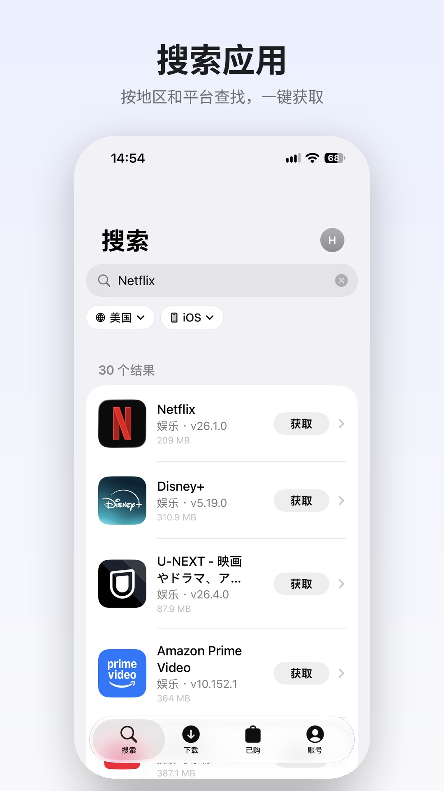
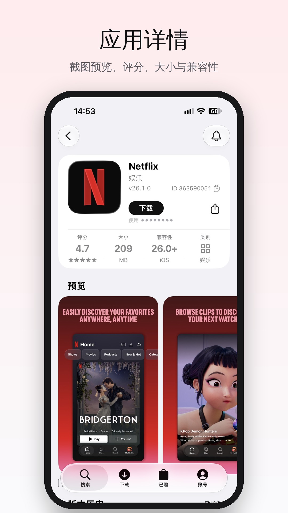
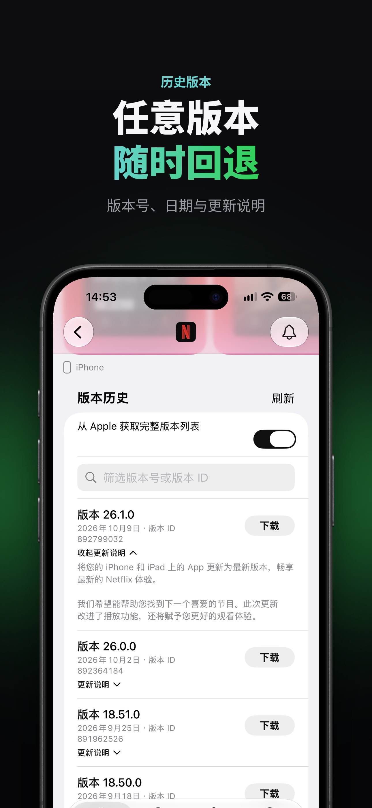
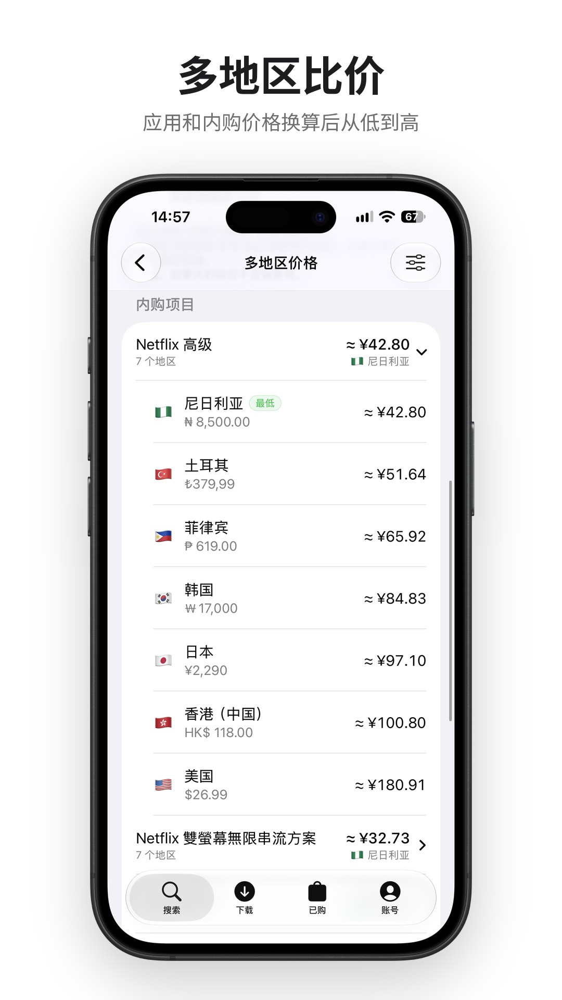
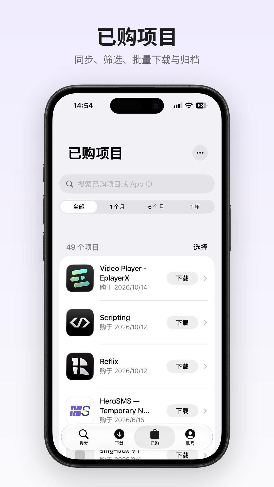

# iPadn

**Search, download and install the apps you own, on iPhone and iPad.**
Works with iPhone, iPad, Apple TV and Mac apps, including older versions and apps removed from sale.

[Download](https://github.com/mengangs/ipadn/releases/latest) · [Install a download](#installing-a-downloaded-app) · [FAQ](#frequently-asked-questions) · [Report a problem](https://github.com/mengangs/ipadn/issues)

中文版说明见 [README.md](README.md)。

  
  
  
  
  

---

## What it does

| | |
| --- | --- |
| 🔍 **Search** | Search by app name, App ID or App Store link, and switch storefront or platform (iPhone / iPad / Apple TV / Mac). The details page has screenshots and other apps by the same developer. |
| 🕘 **Older versions** | See each version's number, date and release notes, and download older builds, or type a version ID directly. A downloaded app can “keep this version” so it stops reminding you about updates. |
| ⬇️ **Downloads** | Background downloads you can pause, resume and retry, with live speed and time remaining. |
| 🔔 **Update reminders** | Downloaded apps are flagged in the list when a newer version exists, and a background check sends a notification. |
| ⬆️ **iPadn update reminders** | When iPadn itself has an update, Settings says so and a notification is sent; you can read what's new, download the new package in the app and hand it to your signing tool. |
| 👀 **Follow apps** | Follow an app to be told about new versions, price drops, free promotions or removal, and to keep a price history. |
| 🌏 **Regional prices** | Compare an app and its in-app purchases (subscriptions included) across countries and regions, converted to the currency you pick and sorted from cheapest, with the regions chosen by you. |
| 📲 **One-tap install** | Tap “Install” when a download finishes; no profile or certificate needed, and install progress is shown. |
| 💻 **Mac apps** | Download PKG packages for Mac App Store apps and install them on a Mac. |
| 🛍️ **Purchases** | Sync every app you've acquired, find them by name or date, select several and download them in one go; find removed-but-downloadable apps and back them all up, and export the list as a spreadsheet. |
| 📦 **Removed apps** | If you acquired an app once, it can still be found and downloaded by App ID after it leaves the store. |
| 👥 **Multiple accounts** | Keep several Apple accounts (email or phone number) and switch between them. |
| 🎮 **Apple Arcade** | Accounts with an Apple Arcade subscription can download Arcade games. |
| 🧰 **Pro mode** | Browse the files inside a package and extract them, and view account tokens and the device identifier (off by default). |

The interface follows App Store conventions: appearance follows the system and the icon is dark by default (both can be changed in Settings), Dynamic Type and the iPad sidebar are supported, and the app icon can be changed in Settings.

## Getting started

> Requires **iOS / iPadOS 17** or later.

1. Download the latest `iPadn-<version>-unsigned.ipa` from [Releases](https://github.com/mengangs/ipadn/releases/latest).
2. Sign it with your usual signing tool and install it on the device.
3. Open iPadn and sign in to your Apple Account under **Account**. If two-factor authentication is needed, enter the 6-digit code shown on a trusted device.

> iPadn isn't on the App Store. Released packages are unsigned, so you sign them yourself.

## Downloading an app

1. Type an app name, App ID or App Store link into **Search**.
2. Tap “Get” to download the latest version, or open the details page and pick an older one under **Version history**.
3. Follow the progress under **Downloads**, then tap “Install” or the share button.

**Tips**

- To download the Apple TV or iPad version, switch the platform under the search field.
- Can't find an app that was removed? Search for its App ID.
- After signing in, the details page asks Apple for the full version list by default; apps your account never acquired show the public version details instead.
- Touch and hold a download card to see its details, export the file or delete the task.
- To download several purchases at once, tap “Select” under **Purchased**, pick them, then tap “Download selected”.
- Low on space? Delete old packages with one tap under **Account › Settings › Storage**.

## Installing a downloaded app

Tap “Install” on a download card and confirm the system prompt. Don't leave iPadn until the installation finishes.

You can choose how installs work under **Account › Settings › Installation settings**:

| Method | Who it's for | What it needs |
| --- | --- | --- |
| **One-tap install** (recommended) | Everyone | Nothing to set up; just a network connection when installing |
| **Local certificate** | When one-tap install shows no install prompt (running inside LiveContainer, for example) | Create a certificate in Installation settings, install the profile and enable trust under Settings › General › About › Certificate Trust Settings |
| **Proxy service** | People already using Surge, Loon and similar tools | Your own manifest service address and proxy rules |

With the local certificate, the system asks whether “ipadn.localtest.me” may install — that's the installation service iPadn runs on the device itself. If you use Surge, Loon, Shadowrocket or a similar proxy, you don't have to turn it off: add a DIRECT rule for `api.palera.in` (one-tap install) or `ipadn.localtest.me` (local certificate).

Progress is shown while installing: the system starting, the package transfer percentage, and the transfer finishing. If no system install prompt appears after tapping “Install”, tap “Install in Safari”, confirm there, then come back to iPadn and wait.

If the device already has a newer version of the same app, the system may ask you to delete it first, which also deletes the app's data.

You can also tap the share button to hand the package to another installation tool.

## Mac apps

1. Switch the platform to **Mac** under the search field.
2. Open the app's details page and tap “Get PKG”.
3. When it finishes, tap the share button and send it to your Mac with AirDrop or the Files app.

The first Mac download also fetches about 47 MB of components, which are reused afterwards. DMG / PKG / ZIP builds offered on the developer's website can be downloaded from the details page too.

## Pro mode

Turn on “Pro mode” under **Account › Settings** to:

- Browse a download's package contents from its task details: view any file and extract it for sharing, with text and images previewed directly.
- See “Account & device identifier” in Settings, where you can view account tokens and change the device identifier. A token can access your Apple Account directly, so never share it; after changing the device identifier, accounts may need to sign in again.

## Your data

- Account details stay on your device; verification codes are never saved.
- Downloaded packages stay on the device and are never uploaded anywhere.
- Price comparison fetches reference exchange rates from open.er-api.com; those requests contain no account information.
- Removing an account doesn't delete downloaded packages. Deleting a download task deletes its file too, and asks for confirmation first.

## Frequently asked questions

<b>Why can't I download a certain app or version?</b>

Apple only allows downloads of apps your account is licensed to use. A version may also have been removed or may not be offered in the current region. Try another version, switch storefront, or switch to the account that owns the app.

<b>Nothing happens after tapping “Install”?</b>

Make sure the device is online and confirm the system prompt. If no prompt appears, tap “Install in Safari”, or switch to “Local certificate” in Installation settings (especially inside LiveContainer). If it still fails, share the package with another installation tool, or export diagnostics under Settings › Maintenance and send them to us.

<b>“Already installed, delete it and try again”?</b>

Apps installed from the App Store can be installed over with the same or a newer version, keeping their data. This message usually means either the version you're installing is older than the installed one (iOS doesn't allow downgrades), or the installed copy came from TestFlight or another signing tool, whose signature doesn't match. In both cases you have to delete the installed app first, which also deletes its data.

<b>How do I find an app that was removed from the store?</b>

Search for its App ID. As long as your account acquired the app once, you can still download it, and its icon is remembered after the first download.

<b>What if a download stalls?</b>

Check the connection, then pause and resume. A failed download can be retried directly and isn't added twice.

<b>Can I download TestFlight builds?</b>

Not currently. Existing IPA files can be imported with the “+” button on the Downloads page.

<b>Why do regional prices show only China's in-app purchases?</b>

On mainland Chinese networks Apple redirects other regions' App Store pages to China, so their in-app prices can't be read (the app's own price is unaffected). Route apps.apple.com through your proxy, then pull to refresh.

<b>Does removing an account delete downloaded apps?</b>

No. Removing an account only clears that account's sign-in details and purchase records.

## More

- [Release notes](RELEASE_NOTES.md)
- [Building from source](iPadn-iOS/BUILDING.md)
- [Third-party components and licenses](iPadn-iOS/THIRD_PARTY_NOTICES.md)

## License

iPadn is released under [GPL-2.0-or-later](LICENSE): you may use, modify and redistribute it, and modified versions must be released under the same license.

iPadn is not affiliated with Apple Inc. Only download apps you are legally licensed to use.
