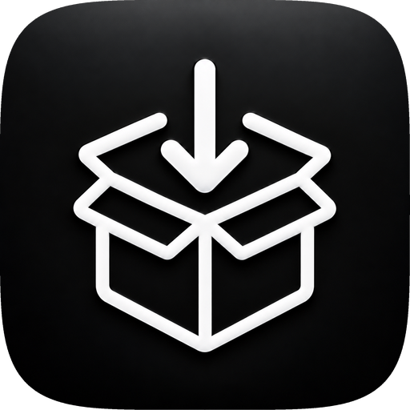
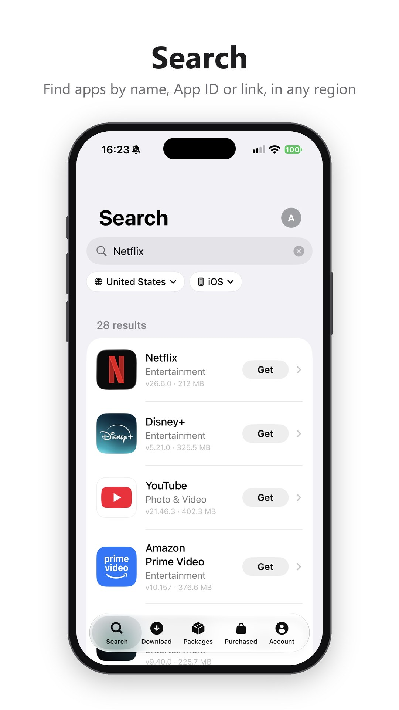
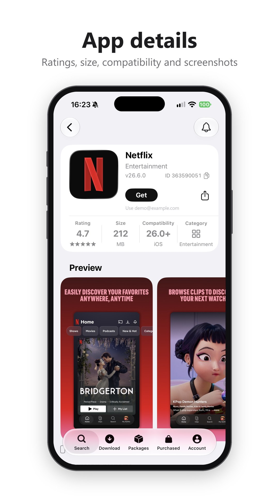
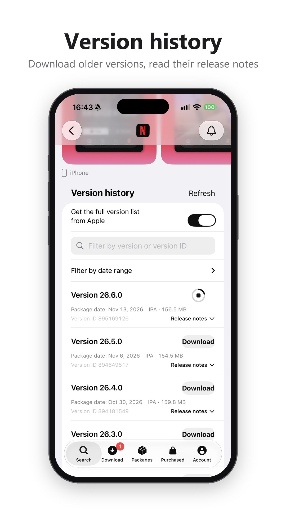
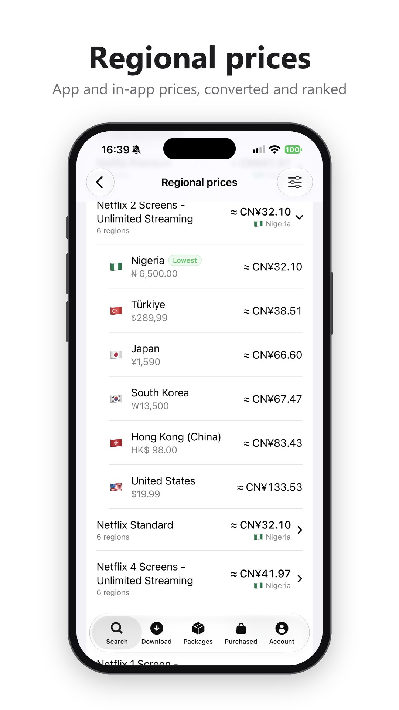
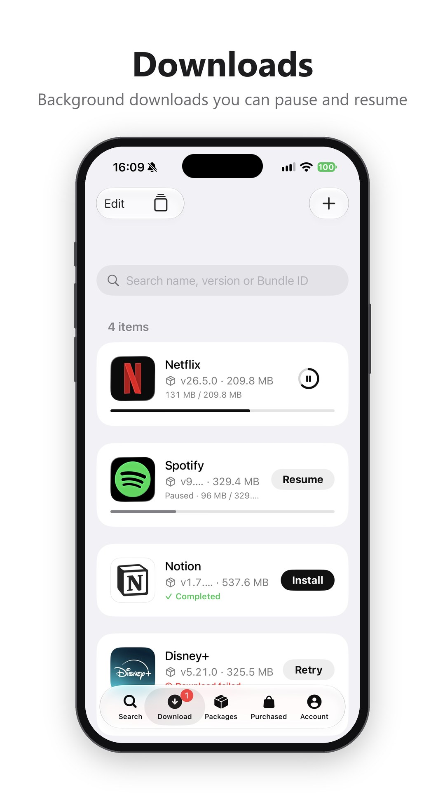
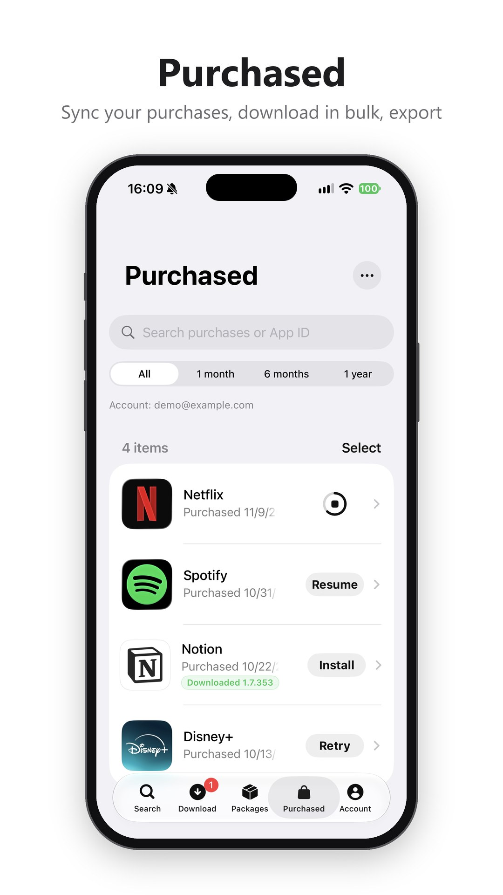
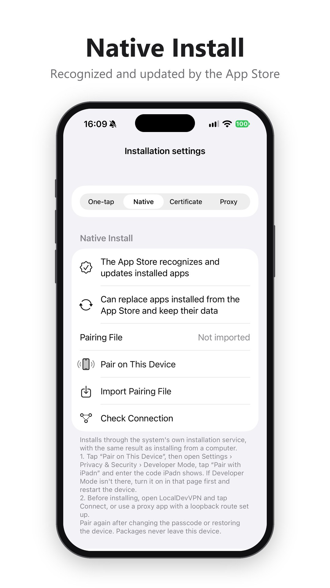
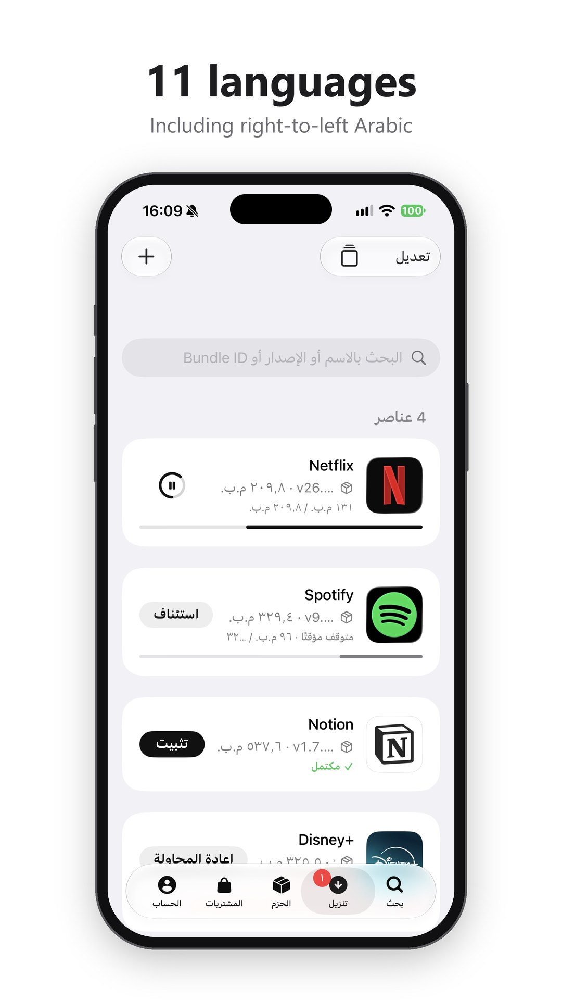

<div align="center">



# iPadn

**Search, download and install the apps you own, on iPhone and iPad.**
Works with iPhone, iPad, Apple TV and Mac apps, including older versions and apps removed from sale.

✨ **New in v2.3.2: Full purchase history & delisted app sync · TestFlight sign-in & Dark Mode update badge fixes** · 📢 **Prefer [Official Telegram Channel](https://t.me/ipadn_official) for first releases & feedback**

[](https://github.com/mengangs/ipadn/releases/latest)
[](https://t.me/ipadn_official)
[](https://github.com/mengangs/ipadn/releases)

[](LICENSE)

<p>
  <a href="#support-ipadn"></a>
  <a href="https://afdian.com/a/mengangs"></a>
</p>

[简体中文](README.md) · **English**

[Download](https://github.com/mengangs/ipadn/releases/latest) · [Official Telegram](https://t.me/ipadn_official) · ❤️ [**Support iPadn**](#support-ipadn) · [TestFlight Guide](#testflight-experimental) · [Install a download](#installing-a-downloaded-app) · [FAQ](#frequently-asked-questions)

</div>

> [!IMPORTANT]
> **Join Telegram & GitHub Issues Archive**: To focus limited maintainer bandwidth on core engineering and faster user support, **new builds and source archives are now released first in our [Official Telegram Channel (`@ipadn_official`)](https://t.me/ipadn_official)** (with GitHub synced slightly later). **GitHub Issues are now closed to new reports** while existing issues remain as a read-only searchable archive — please post questions and bug reports **under the matching version post** in Telegram.

<p align="center">
  
  
  
  
</p>

<p align="center">
  
  
  
  
</p>

---

## What’s new in 2.3.2

- **Full Purchase History & Delisted App Recovery**: Adds Apple's `/commerce/account/purchases` history endpoint alongside DMAP so older and delisted apps (with multi-locale purchase dates) are no longer missing; runs initial full-history sync with **6 concurrent workers** and live year progress, persists state so subsequent refreshes only scan the current year incrementally in seconds, and adds a **Sync Full Purchase History** menu action.
- **Fixed Purchased List Icons Staying Gray After Account Switch**: Removes the storefront-sync race that aborted `loadOwnedArtwork()` on account switch, scopes deduplication per storefront (`country|appId`), increases batch size to 50, and preserves cached icon URLs across merges.
- **Fixed TestFlight Sign-In Error Classification & Stale Device Slots**: Automatically wipes and re-provisions stale cached `iphone` slots returning `rinfo=67437824` (with GSA fallback), and stops matching `"iphone"` as a multi-phone verification error.
- **Fixed Dark Mode Update Badge Contrast**: Switches the Account › Settings update pill text from hardcoded white to `UX.onAccent` on `UX.tint`. See the [release notes](RELEASE_NOTES.md).

## What’s new in 2.3.1

- **Restored iOS / iPadOS 16 Compatibility (thanks [@tageniu](https://github.com/tageniu) for PR #108)**: Restores the **iOS 16.0** deployment target with weak-linked iOS 17+ frameworks (`Symbols`, `Translation`, `ActivityKit`), falls back to HMAC-SHA1 PKCS#12 MAC on iOS 16, registers `SigningCapability.swift` in `iPadn.xcodeproj`, and aligns `iPadnLiveActivity` availability checks across Xcode and `xtool`.
- **Smooth Version History Scrolling & Instant Account Switching**: Extracts `VersionIconCache`, uses race-free chunked `URLSessionDataDelegate` range reads with prefix-filtered `RemoteZip` parsing off the main actor, flattens `AppDetailView` into a single `LazyVStack` to prevent fast-scroll stalls/blanking, isolates `AccountsView` & `NoticeCenter`, switches accounts cleanly in place on the Accounts tab, and replaces heavy material toast animations with a lightweight elevated capsule.
- **Post-Failure Cross-Region Diagnosis & Account Switch (`2059` / `1010`)**: Only after an actual `2059`/`1010` failure (never pre-blocking working cross-region downloads), shows a concise region mismatch alert with **Switch & Retry** (when a matching signed-in account exists) or **Switch Account**.
- **TestFlight / CI Reliability**: Expands `SAPSigner` cold-boot WebKit warm-up bounds.

## What’s new in 2.3.0

> **v2.2.1 → v2.3.0 Milestone Jump**: Since the last GitHub release (**v2.2.1**), iPadn accumulated **20+ consecutive local feature & architecture iterations** before tagging **v2.3.0**—headlined by a brand-new **TestFlight hub (Experimental)**, an in-app Standard/Lite update picker, localized titles, and our official Telegram community hub.

- **🆕 TestFlight Hub, SINF Downloads & Unified Install (Experimental)**: Built a dedicated Store-styled **Account › TestFlight** page separating builds into **Testing**, **Incompatible**, and **Previously Tested**, with keyword filtering, localized app titles, and multi-account avatar switching. Supports live speed/ETA cards, injected SINF for zero-decrypt **Native Install** via `InstallCoordinator`, read-only projection into **Downloads** & Pro mode **Packages** (with `FairPlayCore` decryption resolution), and `TFNet` networking controls (Follow System / Force Direct / Force Proxy), automatic single direct bypass, DoH/fake-IP preflight diagnostics, and strictly redacted rotating logs.
- **⬆️ In-App Update Variant Picker (`AppUpdateView`)**: Surface timely release alerts and pick **Standard** or **Lite** builds directly inside the update sheet with size and changelog preview.
- **🌏 Localized Names & Polish**: Prefer localized app names across TestFlight, Store, Downloads, and Pro mode Packages, plus quick Bundle ID copy and responsive UI refinements.
- **📢 Official Telegram Channel (All 11 Languages)**: Adds direct links to [https://t.me/ipadn_official](https://t.me/ipadn_official) in Account › Settings › Support iPadn and SupportView. iPadn stays free and open source, publishes new releases to Telegram first, and archives GitHub Issues as read-only.
- ⚠️ **Experimental Notice & Disclaimer**: TestFlight is newly developed and subject to Apple server behavior, active invite eligibility, and network rules—treat it as experimental and test with a secondary account first. See the [TestFlight Experimental](#testflight-experimental) guide.
- Standard and lite packages remain available for iOS / iPadOS 16 and later.

> For earlier releases, see [GitHub Releases](https://github.com/mengangs/ipadn/releases) and [release notes](RELEASE_NOTES.md).

## What it does

| | |
| --- | --- |
| ✈️ **TestFlight (🆕 Experimental)** | Browse and download your account's TestFlight apps under Account › TestFlight: grouped by Testing / Incompatible / Previously Tested with search, multi-account switching, SINF-injected zero-decrypt Native Install, projection into Downloads & Pro Packages, plus `TFNet` proxy bypass and redacted diagnostics. |
| 🔍 **Search & discover** | Search by app name, App ID or App Store link, and switch storefront region and platform (iPhone / iPad / Apple TV / Mac). Recent searches appear as chips. Discover, App Screenshots and Customer Reviews can each be turned off in Settings; when enabled, Discover shows Top Free, Top Paid and Top Grossing for any region by category alongside other apps by the same developer. |
| 🌐 **Translation** | Descriptions and release notes use the system translation sheet by default. On iOS 18+, opt into in-place translation under Settings › Appearance & icon › Translation and prepare languages there. The target follows the app language, with Show original. |
| 🕘 **Older versions** | See each version's number, date, IPA package size, version-specific icon and release notes and download older versions, or enter a version ID directly. Long-press a row to copy its version number or ID; accessibility text sizes use a vertical layout. Unavailable sizes show “—”, never the latest version's size. Primary icon PNGs are read on demand from each version's IPA and cached separately (or disable loading in Appearance & icon settings to save bandwidth). Unavailable icons use a placeholder, never current store artwork; asset-catalog-only icons are not yet supported. Downloaded apps can “Keep this version” to stop update reminders. |
| ⬇️ **Downloads** | Background downloads you can pause, resume and retry, with live speed and time remaining, also on the Lock Screen and in the Dynamic Island. Download over Wi‑Fi only and install automatically when a download finishes if you like. Swipe cards to delete or share; tap elsewhere to close the actions. Exported filenames include the app name and version. Deletion offers a five-second Undo countdown, and completion changes the progress ring to a checkmark and Install. Long-press uses the system menu; tap the selected tab again to scroll to the top. Task details show the permissions, extensions and languages a package declares. |
| 🔔 **Update alerts** | Downloaded apps with a newer version are marked in the list, and background checks send a notification. |
| ⬆️ **iPadn updates** | New iPadn releases appear in Settings with a notification; read what's new, download the new package and hand it to your signing tool. |
| 👀 **Follow apps** | Get notified about new versions, price drops, free promotions or removals, with a price history. |
| 🌏 **Regional prices** | Compare app and in-app purchase prices (including subscriptions) across regions, converted to your chosen currency and sorted from lowest. You pick the regions. |
| 📲 **One-tap install** | Tap “Install” when a download finishes. No profile or certificate needed, with live progress. |
| 🧩 **Native install** | Installs through the system's own installation service, with the same result as installing from a computer: the App Store recognizes and updates the app, and an App Store copy can be replaced in place with its data kept. You can also block App Store updates for the app. From iOS 27, pairing is done on the device without a computer. |
| 📱 **Apps on this device** | Lists the apps installed on your phone and updates every app with a newer App Store version in one go. Apps without a store listing still open their on-device version, bundle ID and other available information. Missing regional listings and failed requests are distinguished, with a separate store-query retry. |
| 💻 **Wi‑Fi transfer** | Download finished packages in a browser on a computer on the same Wi‑Fi, only while the page is open. |
| 💻 **Mac apps** | Download PKG installers of Mac App Store apps and install them on a Mac. |
| 🛍️ **Purchases** | Sync every app you've acquired, find them by name or date, and download several at once. Find removed apps that can still be downloaded and back them all up; export the list as a spreadsheet. |
| 📦 **Removed apps** | If you acquired an app once, you can find and download it by App ID or keyword/alias search even after removal from sale, with an option in Settings to prioritize matching delisted apps at the top of search results. |
| 👥 **Multiple accounts** | Save several Apple Accounts (email or phone number) and switch with one tap. |
| 🎮 **Apple Arcade** | Accounts subscribed to Apple Arcade can download Arcade games. |
| 🔒 **App lock** | Lock iPadn with Face ID, Touch ID or your passcode; its content is hidden in the app switcher too. |
| 🧭 **Widgets & Shortcuts** | Home Screen and Lock Screen widgets open Search, Downloads, Purchased or the update check; Shortcuts actions download apps, check for updates, report download progress, follow apps and more. |
| 🧰 **Pro mode & decryption** | Enabling Pro mode unlocks the Packages tab, package file browsing/extraction, two-version comparison, account token/device ID inspection, and on-device FairPlay SINF IPA decryption with slice-by-slice verification (off by default). |
| 🛡️ **Backup & maintenance** | Export or selectively restore plaintext and AES-256-GCM password-encrypted backups (settings, followed apps, version sources, Apple session credentials and StoreProof), plus storage cleanup and redacted diagnostics export. |

The interface follows the App Store's design. Appearance follows the system and the icon is dark by default (both can be changed in Settings), with Dynamic Type, the iPad sidebar and alternate app icons.

**Languages:** English, Simplified Chinese, Traditional Chinese, Japanese, Korean, Russian, Spanish, French, German, Portuguese (Brazil) and Arabic, with a right-to-left layout for Arabic. iPadn follows the system language; to choose a different one for iPadn only, use Settings › iPadn › Language. English was refined by a community contributor and the other languages are machine-assisted translations; corrections are welcome in our [Official Telegram Channel](https://t.me/ipadn_official) or a pull request.

## Getting started

> Requires **iOS / iPadOS 16** or later.

1. Download the latest `iPadn-<version>-unsigned.ipa` from [Releases](https://github.com/mengangs/ipadn/releases/latest). If your signing tool or free account has few App IDs left, use the lite package `iPadn-<version>-lite-unsigned.ipa` instead: it needs one App ID but has no Dynamic Island progress or widgets.
2. Sign it with your usual signing tool and install it on your device.
3. Open iPadn and sign in to your Apple Account under Account. If two-factor authentication is on, enter the 6-digit code shown on your trusted device.

> iPadn isn't on the App Store. Releases are unsigned, so you need to sign them yourself.

### Add the source to your signing tool

SideStore, AltStore, Feather and other tools that support AltStore sources can add the address below. You can then install iPadn from the tool and update it there when a new version is out, without downloading the package by hand.

```
https://raw.githubusercontent.com/mengangs/ipadn/main/altstore-source.json
```

The source is updated automatically after every release and only lists packages from this repository's Releases.

## Downloading an app

1. In **Search**, enter an app name, App ID or App Store link.
2. Tap “Get” to download the latest version, or open the app page and choose an older version under **Version history**.
3. Follow the progress in **Downloads**, then tap “Install” or the share button.

**Tips**

- For Apple TV or iPad versions, switch the platform below the search field.
- Can't find a removed app? Search for its App ID.
- When signed in, app pages load the full version list from Apple; apps your account hasn't acquired show the public version details.
- Touch and hold a download card to see details, export the file or delete the task.
- To download several purchases at once, tap “Select” in Purchased, tick them and tap “Download selected”.
- Packages taking too much space? Delete older versions in one go under Account › Settings › Storage.
- Version history incomplete? In the version source list under Account › Settings, tap “Check All Sources” to see whether each source works. In an endpoint URL, `{id}` or `{appId}` stands for the App ID.

## Installing a downloaded app

For a manual install, tap “Install” on the download card and follow the selected method. Web installation methods require confirmation in the system prompt; keep iPadn open until they finish.

With “Install When Downloaded” enabled and Native install selected, completed downloads install sequentially without another confirmation. Pair beforehand and keep LocalDevVPN connected. Silent audio keeps the app running from downloading through installation; Lock Screen and Dynamic Island activities can show downloading, processing and installation states (standard package, with Live Activities enabled). iOS still controls background execution, so work cannot be guaranteed after the system terminates the app; reopening iPadn resumes pending work. Other methods still need iPadn in the foreground and their installation page and system prompts.

Choose the install method under Account › Settings › Installation settings:

| Method | For | What you need |
| --- | --- | --- |
| **One-tap install** (recommended) | Everyone | Nothing to set up; a network connection while installing |
| **Native install** | Getting App Store recognition and updates, or replacing an App Store copy | LocalDevVPN and a one-time pairing, see below |
| **Local certificate** | When one-tap install shows no prompt (for example inside LiveContainer) | Create a certificate in Installation settings, install its profile, and enable trust under Settings › General › About › Certificate Trust Settings |
| **Proxy service** | People already using Surge, Loon and similar tools | Your own manifest service address and proxy rules |

With a local certificate, the system asks “ipadn.localtest.me would like to install…”: that's the installation service iPadn runs on your device. With Surge, Loon, Shadowrocket or another proxy, you don't need to turn it off; add a DIRECT rule instead: `api.palera.in` for one-tap install, `ipadn.localtest.me` for a local certificate.

Installation shows its progress: the system starting, the package transfer percentage, and the transfer finishing. If no system prompt appears after tapping “Install”, tap “Install in Safari”, confirm there, then return to iPadn and wait.

One-tap install, local certificate and proxy service use the system's web installation channel, which can't replace an App Store copy of the same app. Use native install for that.

### Native install

One-tap install, local certificate and proxy service all go through the system's web installation channel. Apps installed that way aren't shown as installed in the App Store and can't be updated there; desktop tools such as 3uTools list them as “shared”; and they can't replace an App Store copy of the same app. Native install uses the installation service desktop tools use instead, with the same result as installing from a computer: the App Store recognizes and updates the app, and an App Store copy is replaced in place with its data kept. Packages never leave your device.

**1. Install LocalDevVPN**

Get [LocalDevVPN](https://apps.apple.com/app/localdevvpn/id6755608044) from the App Store. It only forwards connections inside your device and doesn't go through any outside server. Tap Connect in it before each native install.

**2. Pair (once)**

- **iOS / iPadOS 27 or later, no computer:** In Installation settings › Native install, tap “Pair on This Device”. iPadn opens a guide. Open Settings › Privacy & Security › Developer Mode, tap “Pair with iPadn” and enter the code iPadn shows. The code also appears in the Dynamic Island, on the Lock Screen and in a notification, so you don't need to switch back. Developer Mode must be on; if the switch isn't there, the device has no developer-signed app yet, and it may not appear with enterprise signing.
- **iOS 17.4 – 26:** On a computer, connect the device with [idevice_pair](https://github.com/jkcoxson/idevice_pair) and create a remote pairing (RPPairing) file. Put it in Files › On My iPhone › iPadn and open the Native install page: iPadn imports it automatically. You can also tap “Import Pairing File” to pick it from elsewhere. You only need the computer this once; later installs don't need it.

**3. Check the connection**

Connect in LocalDevVPN, return to iPadn and tap “Check Connection”. Once it says connected, you can install.

Pairing stops working after changing the passcode, restoring the device or untrusting the computer; pair again then. The pairing file is a connection credential for your device, so never share it.

You can also tap the share button to hand the package to another installation tool.

## Mac apps

1. Switch the platform below the search field to **Mac**.
2. Open the app page and tap “Get PKG”.
3. When the download finishes, tap the share button and send it to your Mac with AirDrop or Files to install it.

The first Mac download fetches about 47 MB of extra components, which are reused afterwards. DMG / PKG / ZIP installers the developer offers on their website can also be downloaded from the app page.

## TestFlight Experimental

> [!WARNING]
> **Experimental Status, Stability & Disclaimer**: The TestFlight module debuts in **v2.3.0** as an **experimental feature**. Because it depends on Apple server behavior, active per-account beta invitations, local proxy/DNS rules, and on-device pairing state, you may run into session expiration, re-authentication prompts, 401/risk checks, or interrupted downloads. **Testing with a secondary Apple Account first is recommended, and never share pairing files, tokens, or unencrypted backups.** Released under [GPL-2.0-or-later](LICENSE) and unaffiliated with Apple Inc. for authorized testing and personal research only—the author assumes no liability for account restrictions or data loss.

**Quick start:**

1. Open **Account › TestFlight** and sign in or switch accounts via the top-right avatar (TestFlight sessions are stored per DSID and intentionally isolated from iOS App Store sessions, so TF may ask for its own initial sign-in).
2. Apps are grouped into three buckets: **Testing** (active iOS builds eligible for this device), **Incompatible** (macOS / tvOS / visionOS / iPad-only builds), and **Previously Tested** (expired or retired builds shown read-only).
3. Tap download for live speed/ETA progress. Downloaded builds include injected SINF bound to your `ApplicationDSID` and run directly via **Native Install** (with device pairing + LocalDevVPN) **without needing decryption or re-signing**, or can be exported/shared and inspected/decrypted under Pro mode › **Packages** when App Group access is available.
4. If catalog loading stalls or fails with network/401 errors, open **Network & Diagnostics** inside TestFlight to switch between **Follow System / Force Direct / Force Proxy**, check DNS/fake-IP preflight results, and copy strictly redacted logs when reporting under the release post in [Official Telegram](https://t.me/ipadn_official).

## Pro mode

After turning on Pro mode under Account › Settings:

- A Packages tab appears for managing original IPAs and decrypted outputs, running on-device FairPlay SINF decryption and verification on legally acquired packages, and inspecting or sharing strictly redacted decryption logs.
- Download task details offer “Browse package contents”, where you can view and extract any file and preview text and images.
- Package info can compare a download with other downloaded versions of the same app: version, permissions, extensions, frameworks and more.
- Settings shows “Account & device identifier”, with account tokens and the option to change the device identifier. Tokens give direct access to your Apple Account, so never share them; after changing the device identifier, accounts may need to sign in again.

## Your data

- Account details are stored only on your device; verification codes are never saved. Portable backup files are generated only when you explicitly export one under Settings › Backup & Maintenance (with optional PBKDF2-HMAC-SHA256 + AES-256-GCM encryption).
- Downloaded and decrypted packages stay on your device and are never uploaded anywhere. Wi‑Fi transfer runs only while its page is open, uses an address with a random key, answers only devices on your local network and stops when you leave the page.
- Price comparison fetches reference exchange rates from open.er-api.com; requests contain no account information.
- Removing an account doesn't delete downloaded packages. Deleting a download task also deletes its file, after a confirmation.

## Frequently asked questions

<details>
<summary><b>Why can't I download a certain app or version?</b></summary>

Apple only lets you download apps your account holds a license for. A version may also have been removed or not be offered in the current region. Try another version, switch storefront region, or switch to an account that owns the app.
</details>

<details>
<summary><b>Nothing happens after tapping “Install”?</b></summary>

Make sure the device is online, and tap “Install” in the system prompt. If no prompt appears, tap “Install in Safari”, or switch to “Local certificate” in Installation settings (especially inside LiveContainer). If it still doesn't work, share the package with another installation tool, or export diagnostics under Settings › Backup & Maintenance and send them to us.
</details>

<details>
<summary><b>In LiveContainer, files can't be imported or exported, or one-tap install does nothing?</b></summary>

In LiveContainer, long-press iPadn and turn on “Fix File Picker” in its settings. Importing and exporting packages and diagnostics then works, and one-tap install can show the system install prompt.
</details>

<details>
<summary><b>“Already installed, delete it and try again”?</b></summary>

One-tap install, local certificate and proxy service use the system's web installation channel, and iOS doesn't let that channel replace an App Store copy of the same app. Use native install instead: it replaces the app directly and keeps its data. Native install is still refused when the version you're installing is older than the installed one (iOS doesn't allow downgrades), or when the installed copy came from TestFlight or another signing tool.
</details>

<details>
<summary><b>Why does the App Store show a cloud icon and no update, and desktop tools list the app as “shared”?</b></summary>

The app was installed with one-tap install, local certificate or proxy service. The system's web installation channel drops the purchase record inside the package, so the App Store and desktop tools don't recognize it. Install it once more with native install to fix it; its data is kept.
</details>

<details>
<summary><b>Why does pairing need a computer below iOS 27? Is it only once?</b></summary>

Native install uses the system's own installation service, the same one a computer uses to install apps, and it only accepts paired, trusted connections. Before iOS 27, Apple only lets a computer start that pairing over a cable (you tap “Trust This Computer” and enter your passcode); an app on the phone can't start it, so the pairing file has to be made on a computer first. iOS 27 added on-device pairing under Developer Mode, which is what “Pair on This Device” uses.

You only need the computer once. After the pairing file is imported, it keeps working until you change the passcode, restore the device or untrust the computer. Below iOS 17.4 the system has no such connection, so native install isn't available.
</details>

<details>
<summary><b>Native install says it can't reach the installation service?</b></summary>

- Tap Connect in LocalDevVPN first, and keep Wi-Fi on.
- LocalDevVPN can't run together with another proxy or VPN. Surge, Shadowrocket, Egern and similar tools would need `10.7.0.1/32` added to their routes to stand in for LocalDevVPN; this hasn't been tested.
- If it says the pairing file is invalid, pair again (on iOS 27 or later, just tap “Pair on This Device”).
</details>

<details>
<summary><b>No pairing code, or no “Pair with iPadn” in Settings?</b></summary>

- On-device pairing needs iOS / iPadOS 27 or later, with Developer Mode on.
- Tap “Pair on This Device” first, then go to Settings; iPadn keeps running in the background while pairing. The code appears in the Dynamic Island, on the Lock Screen and in a notification. Allow notifications and Live Activities under Settings › iPadn.
- Pairing stops after 5 minutes of waiting; tap “Pair on This Device” again.
</details>

<details>
<summary><b>Downloading or getting an app asks for a verification code, but none arrives?</b></summary>

- iPadn asks Apple to send the code for you. Codes only go to an iPhone, iPad or Mac signed in to the same Apple Account, never by text message. When “Apple Account Sign-In Requested” appears on that device, tap Allow.
- If it doesn't appear, get a code on that device under Settings › [your name] › Sign-In & Security › Get Verification Code; it works the same.
- You can tap “Resend Code”. Apple may stop sending for a while after many requests.
- If getting free apps also asks for verification, the Apple Account usually requires a password for free downloads. On a device signed in to the account, open Settings › Media & Purchases › Password Settings and turn it off; the option isn't there when Face ID is used for purchases.
- Apple sometimes asks for verification again based on its own risk checks. That's up to Apple; the download continues automatically after you verify.
</details>

<details>
<summary><b>Tapping “Get” takes a while before the download starts?</b></summary>

Each request first needs the signature Apple requires, made on your device. Right after opening iPadn, or after more than 5 minutes idle, the signing component takes a few seconds to load; apps you've never downloaded also need a license claimed first, which takes two more requests to Apple. iPadn prepares the signing component when you open an app page, and your downloads go ahead of background work.
</details>

<details>
<summary><b>A download reaches 100% and then starts over?</b></summary>

With some signing methods, the system's background download service can't save files into iPadn, so the download has to run again inside the app. On the first launch after each install, iPadn tests this with a tiny file and switches straight to in-app downloading if needed, so nothing downloads twice. Keep iPadn in the foreground during in-app downloads; they pause about 30 seconds after it goes to the background. After re-signing, tap “Try Background Downloads Again” under Settings › Downloads.
</details>

<details>
<summary><b>How do I find an app that was removed from the store?</b></summary>

Search for its App ID. As long as your account acquired the app once, you can still download it, and its icon is remembered after the first download.
</details>

<details>
<summary><b>What if a download stalls?</b></summary>

Check the connection, then pause and resume. A failed download can be retried directly and isn't added twice.
</details>

<details>
<summary><b>How do I download and install TestFlight builds? Do they need decryption or re-signing?</b></summary>

Open **Account › TestFlight** to view beta apps grouped into Testing, Incompatible, and Previously Tested. After downloading:
- **Native Install**: TestFlight packages include injected SINF tied to the downloading account. With on-device pairing + LocalDevVPN, Native Install runs the beta build directly **without decryption or re-signing**.
- **Sideload / Save**: You can also export/share packages or decrypt eligible builds locally under Pro mode › Packages (requires matching App Group entitlements from your signing tool; otherwise iPadn reports why Native Install is unavailable and offers Save/Share).
</details>

<details>
<summary><b>Why can't I download builds under Previously Tested or macOS-only items?</b></summary>

Due to Apple TestFlight server rules, only active **iOS / iPadOS** builds that your account currently holds an active beta invite for can be downloaded. Expired/retired items under Previously Tested and macOS/tvOS/visionOS-only builds are shown read-only; Apple does not serve historical expired TestFlight builds.
</details>

<details>
<summary><b>Why does TestFlight ask to sign in again, or hit 401 / loading errors?</b></summary>

TestFlight uses an isolated Mac/akd session store scoped per DSID and separated from iOS App Store decryption sessions, so TF may request its own initial sign-in (testing with a secondary account first is recommended). If loading stalls or throws 401/network errors, open **Network & Diagnostics** inside TestFlight to switch between Follow System / Force Direct / Force Proxy, inspect DoH/fake-IP preflight status, and copy redacted diagnostics to our [Official Telegram Channel](https://t.me/ipadn_official).
</details>

<details>
<summary><b>Why do regional prices show only China's in-app purchases?</b></summary>

On mainland Chinese networks Apple redirects other regions' App Store pages to China, so their in-app prices can't be read (the app's own price is unaffected). Route apps.apple.com through your proxy, then pull to refresh.
</details>

<details>
<summary><b>Does removing an account delete downloaded apps?</b></summary>

No. Removing an account only clears that account's sign-in details and purchase records.
</details>

## Support iPadn

<div align="center">

<sub>❤️ ❤️ ❤️</sub>

iPadn is **free, open source and ad-free**.<br>
If it saves you time or you simply enjoy it, you're welcome to buy the author a coffee ☕<br>
Your support keeps the updates coming.

<a href="https://afdian.com/a/mengangs"></a>


| Afdian (Alipay, WeChat Pay) | USDT (BNB Smart Chain / BEP20) |
| :---: | :---: |
| [**afdian.com/a/mengangs**](https://afdian.com/a/mengangs)<br><sub>Monthly or one-time</sub> | <br><code>0x5f0cff7587b9fc305f9fa626135789bd5100818e</code> |

<sub>Before sending USDT, check that the network is BEP20 and the address matches exactly; funds sent on another network or in another token may be lost.<br>You can also scan or copy the address in iPadn under Account › Settings › Support iPadn.<br>Starring the repo, joining our official Telegram channel and improving translations help just as much.</sub>

</div>

## Official Channel & Feedback

- **Official Telegram Channel**: 👉 [**https://t.me/ipadn_official**](https://t.me/ipadn_official)
- **Open-Source & Release Cadence**: iPadn remains **free and open source**, and GitHub continues to publish source code and releases. New builds and source archives are posted first in our official Telegram channel, with GitHub updates following slightly behind.
- **Why GitHub Issues Are Archived (Read-Only)**: Because maintainer time is limited and troubleshooting network/pairing/account behavior works much faster in one thread per release, **GitHub Issues are closed to new submissions while existing historical issues (#1–#106) stay preserved as a read-only archive**. Please post questions, TestFlight feedback, and bug reports **under the matching version post** in Telegram, including your device, OS version, steps, and optionally the redacted diagnostic file from Account › Settings › Backup & Maintenance › Export diagnostics.
- **Translations & Building**: Every interface string lives in [`Localizable.xcstrings`](iPadn-iOS/iPadn/Resources/Localizable.xcstrings); pull requests improving translations are welcome. For building from source, see [BUILDING.md](iPadn-iOS/BUILDING.md).

## Acknowledgements

- [kylefmohr](https://github.com/kylefmohr) contributed the English translation ([#35](https://github.com/mengangs/ipadn/pull/35)).
- Thanks to everyone who reported problems and suggested ideas, and to the open-source projects iPadn uses, listed in [Third-party components and licenses](iPadn-iOS/THIRD_PARTY_NOTICES.md).

## More

- [Release notes](RELEASE_NOTES.md)
- [Building from source](iPadn-iOS/BUILDING.md)
- [Third-party components and licenses](iPadn-iOS/THIRD_PARTY_NOTICES.md)

## License

iPadn is released under [GPL-2.0-or-later](LICENSE): you may use, modify and redistribute it, and modified versions must be released under the same license.

<sub>iPadn is not affiliated with Apple Inc. Only download apps and authorized beta builds you are legally licensed to access; use experimental TestFlight features at your own risk.</sub>
